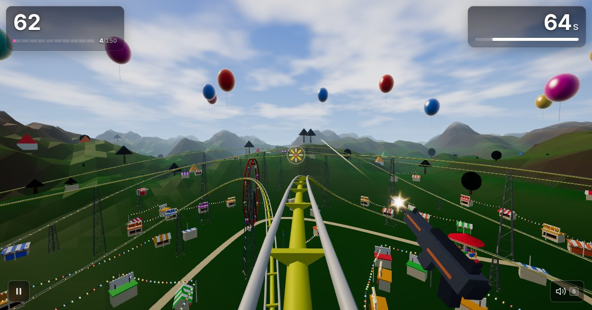

A WebGL on-rails arcade shooter: ride a rollercoaster through five themed worlds and shoot
everything in sight before the timer runs out. Built with React, three.js
(@react-three/fiber) and Tone.js; every model, texture and sound is made in code.

Play it at https://scoaster.com

#### Worlds

 * Theme Park
 * Desert
 * Ocean
 * Antarctica
 * Inferno (volcanic)

Plus a Daily Run: the same seeded ride for everyone, every day.

#### Develop

```bash
npm ci
npm run dev      # dev server
npm run verify   # tests, build, bundle budget, Lighthouse and the headless smoke test
```

`CLAUDE.md` has the full command list and a map of the code.

The original 2015 version (based on mr.doob's rollercoaster and TatumCreative's Polar Space)
still plays at http://alexbelyeu.github.io/shooterCoaster/ from the `gh-pages` branch.

Project copyright (c) 2015 Alex Belyeu under MIT License.
