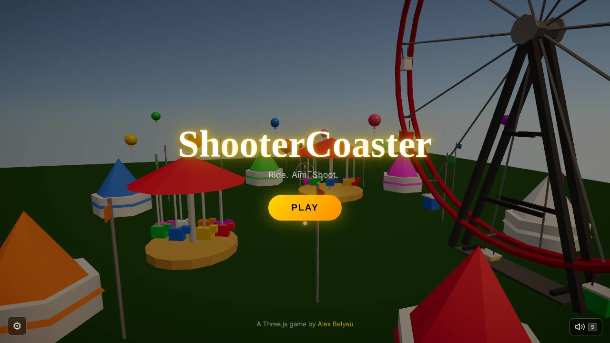
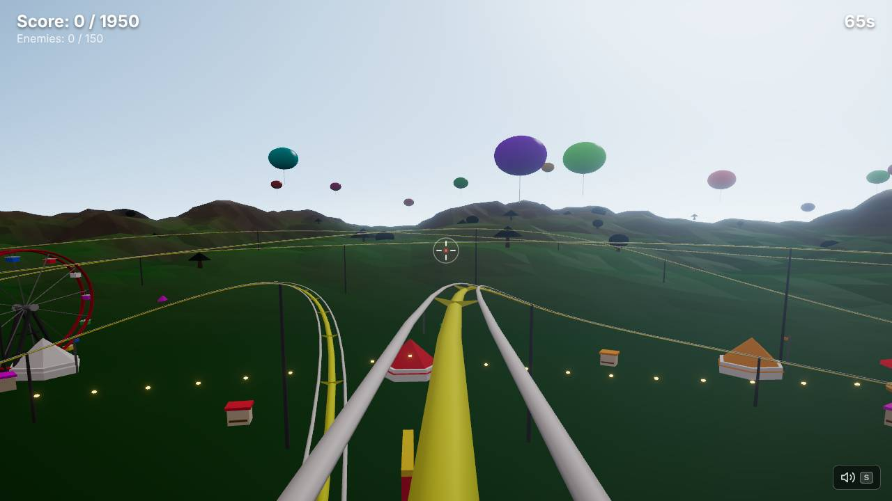
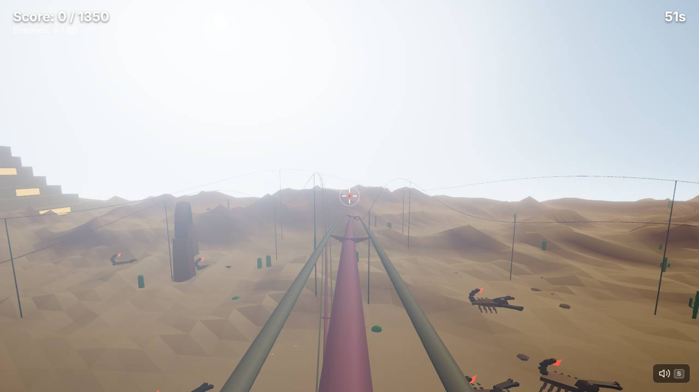
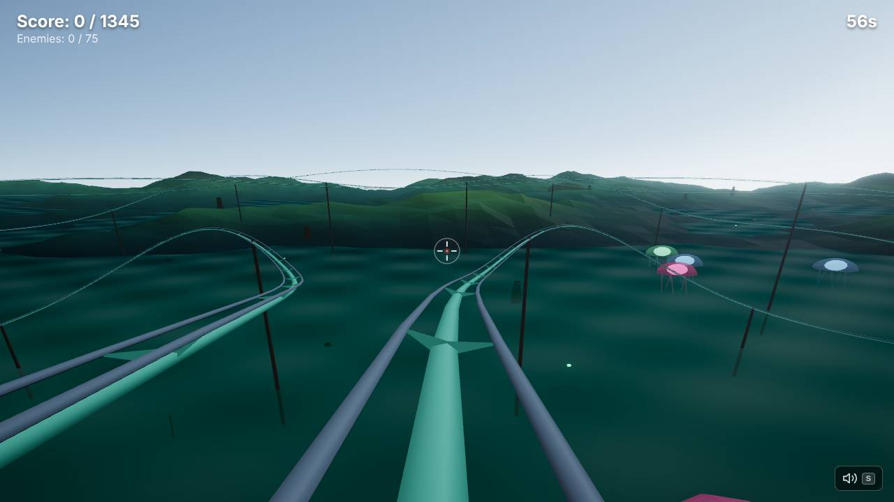
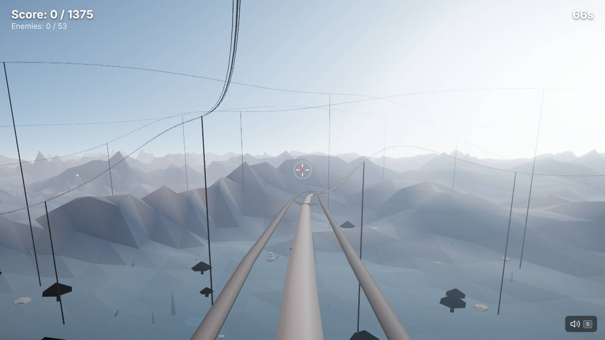
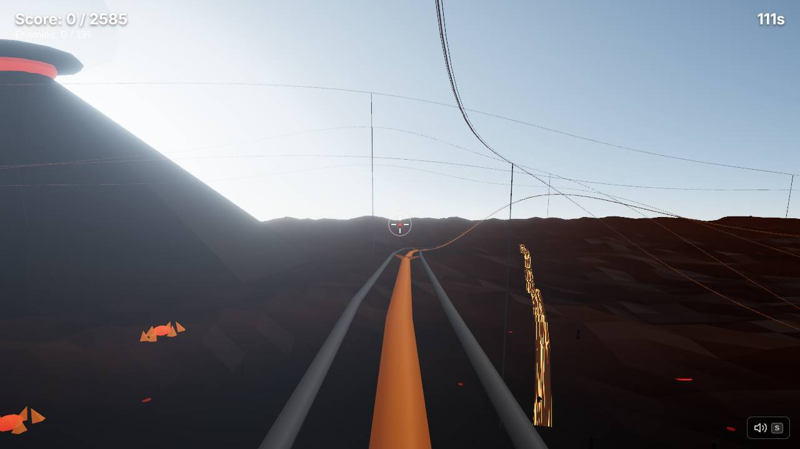

# ShooterCoaster weekly report — 2026-W42 (Mon 12 Oct – Sun 18 Oct)

## Headline

A quiet week for players: nothing changed in the game itself, but the autonomous studio was set up and its first plan landed on Monday 19 Oct. 4 art-direction/feel epics and 30+ ready issues are queued, and two builders have already claimed the sky and track-structure work.

## Play it

https://shooter-coaster.vercel.app

## What's new for players

- Nothing shipped in the game this week (no merged PRs between Mon 12 and Sun 18 Oct).
- Landing on Monday 19 Oct, just after the reporting window: the studio setup ([#6](https://github.com/alexbelyeu/shootercoaster/pull/6)) and the Director's vision, state snapshot and roadmap ([#7](https://github.com/alexbelyeu/shootercoaster/pull/7)). Both are docs/tooling only.
- In progress, not merged yet: per-biome procedural skies ([#12](https://github.com/alexbelyeu/shootercoaster/issues/12), fixes Inferno's blue daytime sky) and proper lattice coaster supports ([#13](https://github.com/alexbelyeu/shootercoaster/issues/13)).

## Screenshots

Latest `main` (32f901d), headless software rendering. These are the baseline the studio will improve on.

**Title**

**Level 1 — Theme Park**

**Level 2 — Desert**

**Level 3 — Ocean**

**Level 4 — Antarctica**

**Level 5 — Inferno** (note the blue daytime sky and wire-thin supports — both are being worked on)

## Under the hood

- CI `verify` (typecheck + build, bundle budget, headless smoke of title and all 5 levels) plus label-gated auto-merge: an approved PR (`agent:qa-approved`) merges itself once `verify` is green.
- Nightly and post-deploy production smoke test that opens an `agent:prod-broken` issue on failure.
- Agent roles, protocol, `budgets.json` and the `docs/agents/` operating files.
- Known gaps: no unit tests yet (queued, [#32](https://github.com/alexbelyeu/shootercoaster/issues/32)); the smoke test never fires a shot, so combat and the results screen are unscreenshotted ([#17](https://github.com/alexbelyeu/shootercoaster/issues/17)).

## Health

| | |
|---|---|
| PRs merged in the window | 0 (2 merged on Mon 19 Oct: #6, #7) |
| Sent back / reverted | 0 / 0 |
| `agent:blocked` / `agent:prod-broken` open | 0 / 0 |
| `npm run verify` on main | PASS (build, bundle, smoke all green) |
| JS bundle | 509 KB gz total (budget 700), largest chunk 215 KB gz (budget 260) |

Per-scene numbers (software GL; draw calls and triangles are reliable, frame time is relative only):

| Scene | Result | Draw calls | Triangles | Avg frame ms |
|---|---|---|---|---|
| Title | PASS | – | – | – |
| Level 1 Theme Park | PASS | 200 | 141,313 | 446 |
| Level 2 Desert | PASS | 186 | 163,735 | 290 |
| Level 3 Ocean | PASS | 96 | 152,109 | 428 |
| Level 4 Antarctica | PASS | 182 | 141,371 | 437 |
| Level 5 Inferno | PASS | 77 | 123,857 | 368 |

Trend: no prior report exists, so this is the baseline. Draw calls and triangles are within a few percent of the Director's snapshot of the same day.

## Next up

Milestone M1 (look and feel). Top queue, by priority:

- P1: [#20](https://github.com/alexbelyeu/shootercoaster/issues/20) Theme Park midway density, [#19](https://github.com/alexbelyeu/shootercoaster/issues/19) Antarctica aurora and ice, [#21](https://github.com/alexbelyeu/shootercoaster/issues/21) Ocean sea stacks, [#22](https://github.com/alexbelyeu/shootercoaster/issues/22) Inferno ash and embers, [#23](https://github.com/alexbelyeu/shootercoaster/issues/23) Desert sand and mesas
- P1: [#18](https://github.com/alexbelyeu/shootercoaster/issues/18) HUD redesign, [#16](https://github.com/alexbelyeu/shootercoaster/issues/16) touch and phone support, [#15](https://github.com/alexbelyeu/shootercoaster/issues/15) enemy readability (black snowmen), [#14](https://github.com/alexbelyeu/shootercoaster/issues/14) hit feedback, [#17](https://github.com/alexbelyeu/shootercoaster/issues/17) gameplay test surface
- In progress: [#12](https://github.com/alexbelyeu/shootercoaster/issues/12) skies, [#13](https://github.com/alexbelyeu/shootercoaster/issues/13) coaster structure

## Steer me

Edit `docs/agents/STEERING.md` on GitHub (web or mobile), or open an issue labelled `steering`. Set `pause: true` there to stop every scheduled run.
