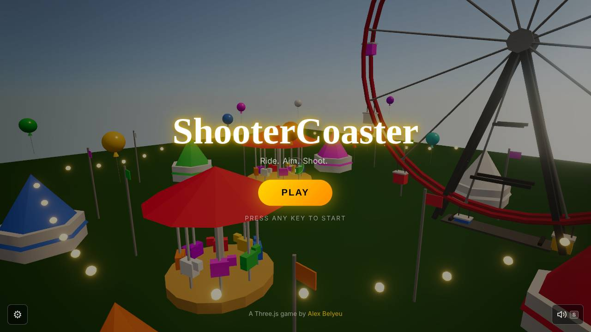
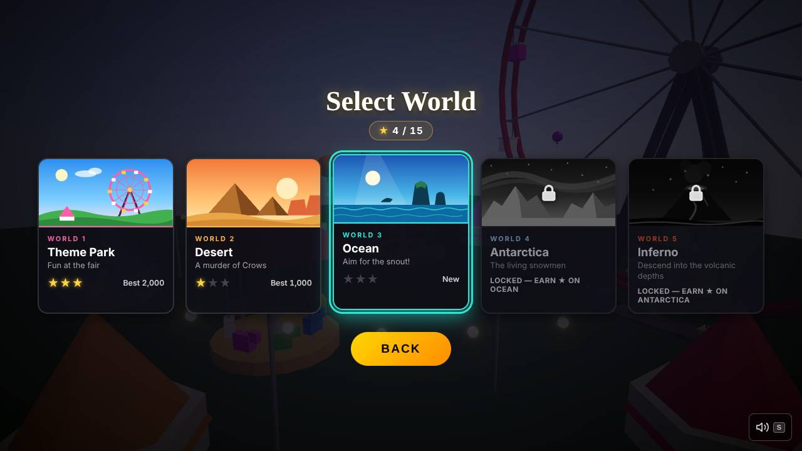
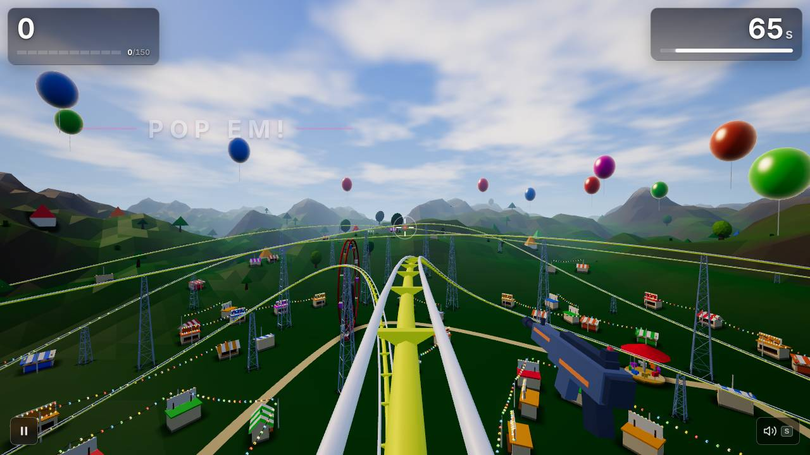
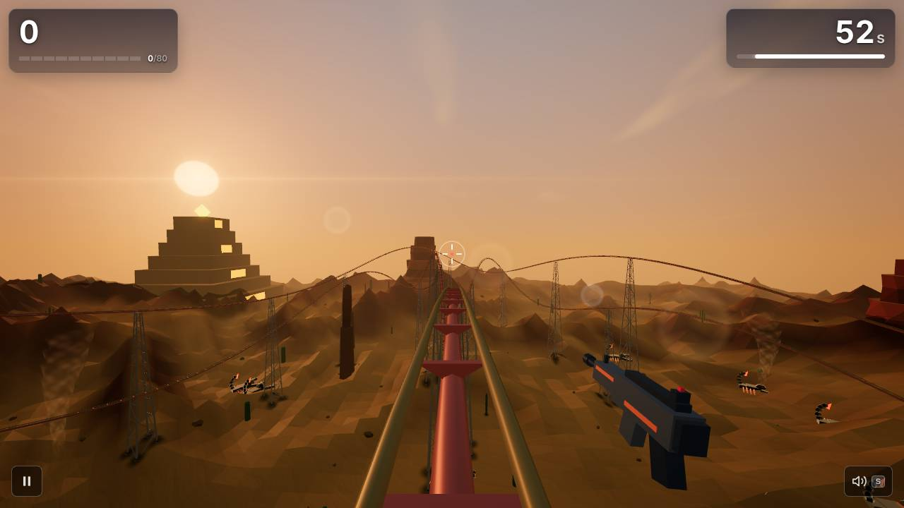
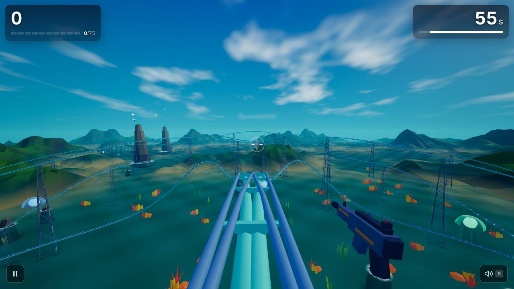
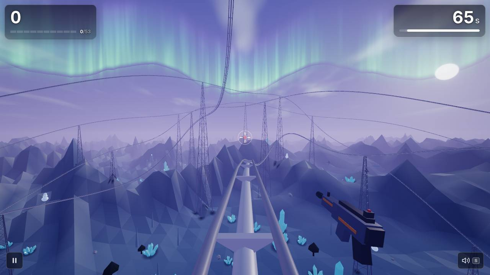
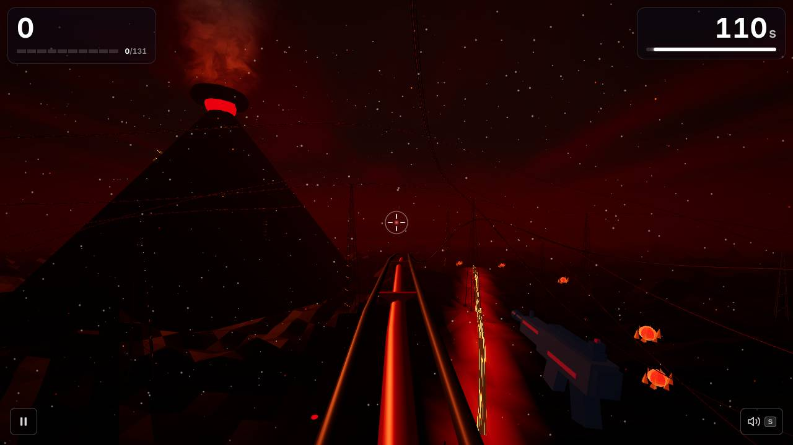
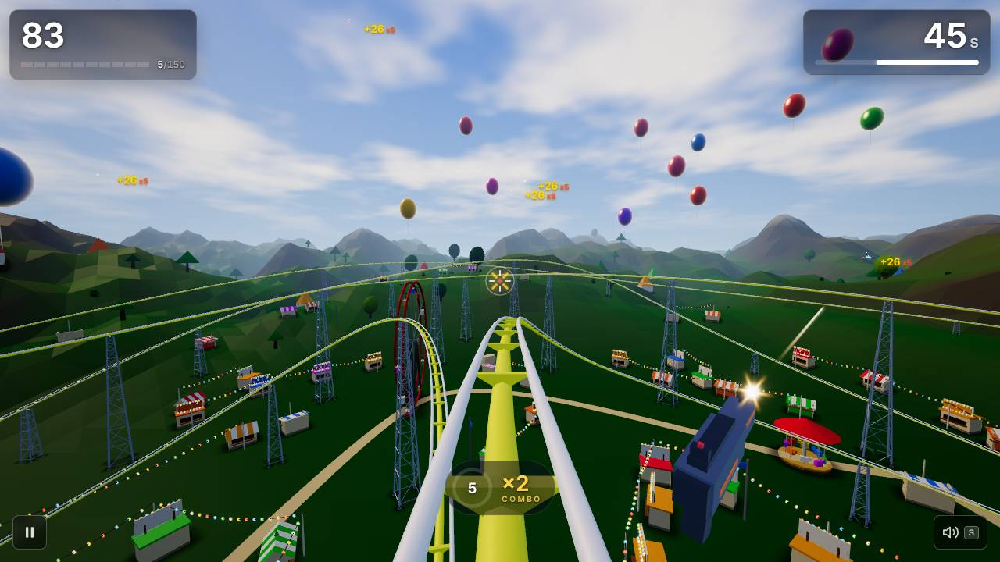
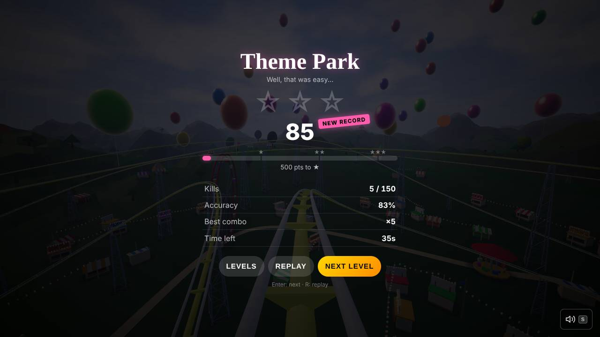

# ShooterCoaster weekly report — 2026-W43 (Mon 19 Oct – Sun 25 Oct)

## Headline

The game went from a bare prototype to something that feels like a game: a real HUD, a star-reveal results screen, a postcard level select, a gun in your hands, camera banking into turns, and all five levels dressed up with their own scenery, skies and colour grades. The Title screen's new fly-by arrived on Monday morning, just after the window.

## Play it

https://scoaster.com

## What's new for players

- **Every level got a makeover:** Theme Park midway ([#75](https://github.com/alexbelyeu/shooterCoaster/pull/75)), Desert sand and mesas ([#84](https://github.com/alexbelyeu/shooterCoaster/pull/84)), Ocean sea stacks ([#80](https://github.com/alexbelyeu/shooterCoaster/pull/80)), Antarctica aurora and ice ([#74](https://github.com/alexbelyeu/shooterCoaster/pull/74)), Inferno ash, embers and lava glow ([#93](https://github.com/alexbelyeu/shooterCoaster/pull/93)). Each has its own sky ([#53](https://github.com/alexbelyeu/shooterCoaster/pull/53)), colour grade ([#145](https://github.com/alexbelyeu/shooterCoaster/pull/145)) and reflective sky lighting ([#137](https://github.com/alexbelyeu/shooterCoaster/pull/137)); trees sway in gusts ([#149](https://github.com/alexbelyeu/shooterCoaster/pull/149)) and props get soft shadows ([#155](https://github.com/alexbelyeu/shooterCoaster/pull/155)).
- **Real coaster supports** (lattice towers) and rails scaled to the track ([#51](https://github.com/alexbelyeu/shooterCoaster/pull/51)).
- **Shooting feels better:** muzzle flash, hitmarker, enemy hit flash ([#60](https://github.com/alexbelyeu/shooterCoaster/pull/60)), a first-person gun with recoil and tracer ([#72](https://github.com/alexbelyeu/shooterCoaster/pull/72)), bullets drawn from the muzzle ([#166](https://github.com/alexbelyeu/shooterCoaster/pull/166)), layered kill sounds by combo ([#107](https://github.com/alexbelyeu/shooterCoaster/pull/107)). Enemies are easier to read, snowmen are white ([#61](https://github.com/alexbelyeu/shooterCoaster/pull/61)).
- **Ride feel:** the camera banks into turns and looks ahead ([#143](https://github.com/alexbelyeu/shooterCoaster/pull/143)), with wind streaks and an FOV kick on fast drops ([#163](https://github.com/alexbelyeu/shooterCoaster/pull/163)).
- **New screens:** HUD with timer bar, animated score and combo meter ([#55](https://github.com/alexbelyeu/shooterCoaster/pull/55)); Ready/Set/GO countdown ([#138](https://github.com/alexbelyeu/shooterCoaster/pull/138)); results screen with star reveal, accuracy, best combo and new-record callout ([#157](https://github.com/alexbelyeu/shooterCoaster/pull/157)); level select with biome postcards, stars and keyboard navigation ([#161](https://github.com/alexbelyeu/shooterCoaster/pull/161)).
- **Phones:** tap to shoot with aim assist, correct portrait view ([#54](https://github.com/alexbelyeu/shooterCoaster/pull/54), [#71](https://github.com/alexbelyeu/shooterCoaster/pull/71)), lighter rendering on touch screens ([#135](https://github.com/alexbelyeu/shooterCoaster/pull/135)).
- **Fixes:** the level timer now pauses when you switch tabs ([#132](https://github.com/alexbelyeu/shooterCoaster/pull/132), [#150](https://github.com/alexbelyeu/shooterCoaster/pull/150)); an audio error that could throw mid-game is gone ([#127](https://github.com/alexbelyeu/shooterCoaster/pull/127)).
- **Share-ready:** scoaster.com is live with a share card and SEO tags ([#96](https://github.com/alexbelyeu/shooterCoaster/pull/96), [#99](https://github.com/alexbelyeu/shooterCoaster/pull/99)).
- Landed Mon 26 Oct morning (outside the window): title fly-by camera, drop-in logo and pulsing PLAY ([#167](https://github.com/alexbelyeu/shooterCoaster/pull/167)).

## Screenshots

Taken on `main` (062c589), headless software rendering.

**Title**

**Level select**

**Level 1 — Theme Park**

**Level 2 — Desert**

**Level 3 — Ocean**

**Level 4 — Antarctica**

**Level 5 — Inferno**

**Combat (Level 1)**

**Results**

## Under the hood

- Unit tests (vitest) now run in CI ([#46](https://github.com/alexbelyeu/shooterCoaster/pull/46)); the smoke test fires real shots, takes combat and results screenshots, checks touch, pause-on-hide, seeded spawns and the countdown ([#44](https://github.com/alexbelyeu/shooterCoaster/pull/44), [#170](https://github.com/alexbelyeu/shooterCoaster/pull/170)).
- Seeded RNG for deterministic spawns and layouts ([#105](https://github.com/alexbelyeu/shooterCoaster/pull/105)); per-biome environment modules ([#68](https://github.com/alexbelyeu/shooterCoaster/pull/68)).
- Bundle: dropped unused Leva, rapier and three-mesh-bvh; main chunk 255 → 195 KB gz ([#131](https://github.com/alexbelyeu/shooterCoaster/pull/131)). It has since grown back to 211 KB with the new features, still under the 260 KB budget.
- Studio: pause switch, independent PR reviews, runbooks for each task ([#73](https://github.com/alexbelyeu/shooterCoaster/pull/73)); decisions inbox ([#64](https://github.com/alexbelyeu/shooterCoaster/pull/64)); live status page ([#56](https://github.com/alexbelyeu/shooterCoaster/pull/56)); weekly Marketer ([#83](https://github.com/alexbelyeu/shooterCoaster/pull/83)); token ledger per run ([#147](https://github.com/alexbelyeu/shooterCoaster/pull/147)); rule that agents never schedule check-ins ([#130](https://github.com/alexbelyeu/shooterCoaster/pull/130)).
- Analytics: Vercel page views plus `level_start` / `level_complete` / `level_quit` events, with a `?internal=1` opt-out ([#97](https://github.com/alexbelyeu/shooterCoaster/pull/97), [#110](https://github.com/alexbelyeu/shooterCoaster/pull/110), [#116](https://github.com/alexbelyeu/shooterCoaster/pull/116)).

## Players

First real numbers (from `docs/marketing/metrics/2026-W43.md`). Treat as noise: 22–23 Oct is mostly Alex testing his own devices and nothing has been posted anywhere.

- 31 visitors, 47 page views; all direct traffic (no referrers). US 25 of 31. 29% on mobile.
- 18 level starts → 8 completes (44%) → 6 quits, from 4 players. Levels 1–3 were played; nobody reached Inferno.
- **Watch:** none of the 9 mobile visitors started a level. Too few to conclude; the Marketer will check again next week.
- UTM breakdowns are paywalled on this plan, so campaign links use `/go/<campaign>` paths ([#171](https://github.com/alexbelyeu/shooterCoaster/issues/171)).
- Waiting for Alex: [#102](https://github.com/alexbelyeu/shooterCoaster/issues/102), a draft three.js forum Showcase post for Mon 2 Nov. A short gameplay clip ([#100](https://github.com/alexbelyeu/shooterCoaster/issues/100)) is the last item before it can go.

## Health

| | |
|---|---|
| PRs merged in the window | 64 (includes setup, docs and decisions-folding PRs) |
| Sent back / reverted | not counted precisely; no reverts. Several PRs had 5–15 comments (QA rounds): #75, #143, #116, #72 |
| `agent:blocked` / `agent:prod-broken` open | 0 / 0 |
| Unit tests, build, bundle check on main (this run) | PASS |
| `npm run smoke` on main (this run) | **FAIL on frame-rate checks only**, see below |
| JS bundle | 498 KB gz total (budget 700), largest chunk 211 KB gz (budget 260) |

**About the smoke failure.** This run's sandbox has 2 CPUs and software rendering, so the game ran at about 0.6 frames per second. The title and all five levels failed only the "render loop stalled / only N frames" checks. Every functional check passed: kills, mouse fire, results screen, seed check, pause-on-hide, countdown, speed effects, level-select keyboard play and the phone touch run. This matches the "smoke flake under load" in the known issues; I could not tell from this run whether CI's runner passes. The GitHub Actions list available to me returned only a single old run, so I have no CI pass rate this week.

Per-level numbers (software GL; draw calls and triangles are reliable, frame time is not):

| Scene | Functional result | Draw calls | Triangles | Kills in test |
|---|---|---|---|---|
| Level 1 Theme Park | frame-rate check only | 96 | 168,975 | 5 |
| Level 2 Desert | frame-rate check only | 287 | 187,846 | 7 |
| Level 3 Ocean | frame-rate check only | 81 | 155,461 | 6 |
| Level 4 Antarctica | frame-rate check only | 176 | 182,389 | 6 |
| Level 5 Inferno | frame-rate check only | 109 | 131,589 | 5 |

Trend vs W42 (draw calls / triangles): L1 213 → 96 / 145k → 169k, L2 294 → 287 / 166k → 188k, L3 107 → 81 / 152k → 155k, L4 182 → 176 / 141k → 182k, L5 134 → 109 / 125k → 132k. Triangles are up 2–29% (scenery); draw calls are flat or down. Draw calls depend on camera position, so compare loosely.

Level 4 had 0 of 4 on-screen enemies marked readable in this run's single sample; worth a look if it repeats.

## Token use

The ledger started on 24 Oct (#147), so this covers 24 Oct → Mon 26 Oct 09:40 UTC only; earlier runs weren't recorded. Weighted tokens, approximate:

| Role | Runs | Total |
|---|---|---|
| Builders | 4 | 17.0M |
| QA | 15 | 5.1M |
| Marketer | 1 | 1.5M |
| Maintainer | 2 | 1.5M |
| **All** | **22** | **25.2M** |

Per PR (builder runs that covered two PRs are split evenly; QA runs count against the PR they reviewed):

| PR | Weighted tokens |
|---|---|
| #155 contact shadows | 4.3M |
| #157 results screen | 4.0M |
| #167 title first 30 seconds | 3.5M |
| #166 bullets from muzzle | 2.6M |
| #161 level select | 2.2M |
| #163 wind streaks | 2.1M |
| #172 W43 metrics (docs) | 1.7M |
| #150 timer fix | 1.3M |
| #149 tree wind | 1.3M |

Top three: #155 and #157 were built in one 110-minute session (221 turns, 6.9M); #155 then needed two QA passes (684k, then 180k after a rework, 8 comments). #167 took a 103-minute build shared with #166, then two QA reviews (939k and 176k) and 7 comments. Large visual features and rounds sent back are what cost most; docs-only work is cheap. No trend yet, this is the first partial week.

## Next up

Milestone M1 is looks and feel, mostly landed. The queue is now small follow-ups, 45 `agent:ready` issues, mostly P3. Top of it:

- P2 [#171](https://github.com/alexbelyeu/shooterCoaster/issues/171): campaign landing paths `/go/`, pinned with a smoke step.
- P3 [#168](https://github.com/alexbelyeu/shooterCoaster/issues/168): music crossfade can leave a gap.
- P3 [#152](https://github.com/alexbelyeu/shooterCoaster/issues/152): pausing restarts wave timers from zero, delaying later waves.
- Also on the marketing path: [#100](https://github.com/alexbelyeu/shooterCoaster/issues/100) gameplay clip for the 2 Nov post.

## Steer me

Edit `docs/agents/STEERING.md` or open an issue labelled `steering` to change direction. Setting `pause: true` there stops everything.
