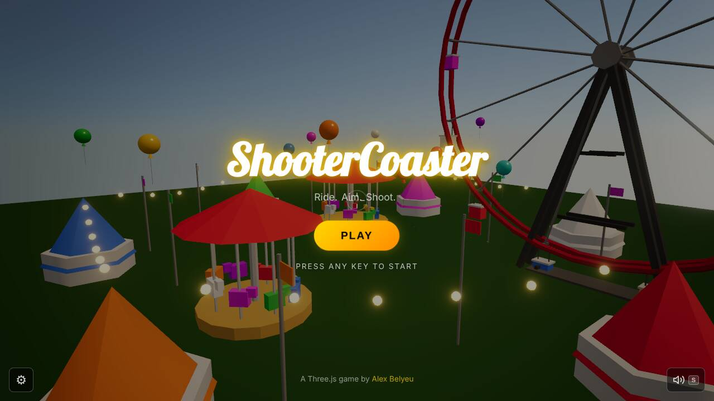
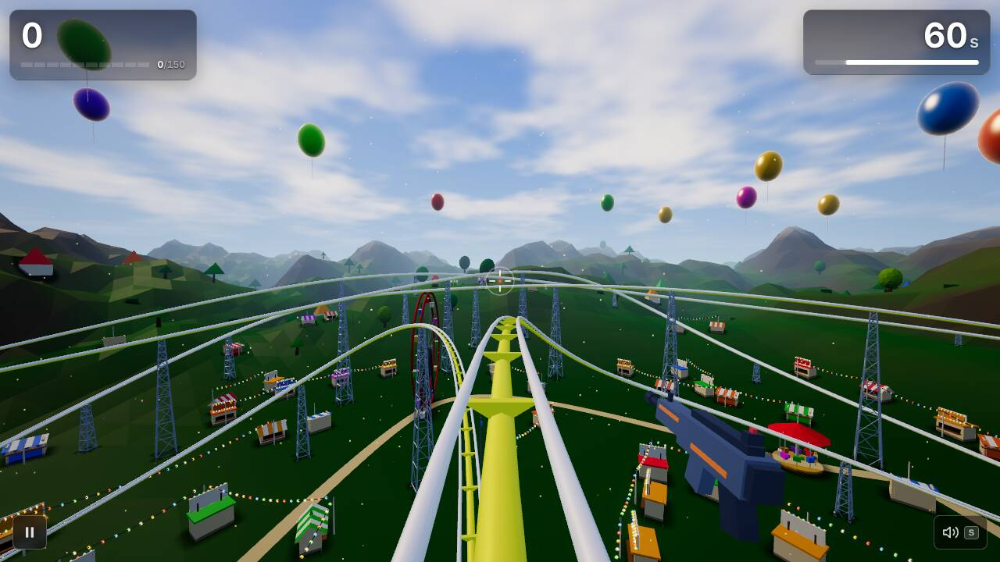
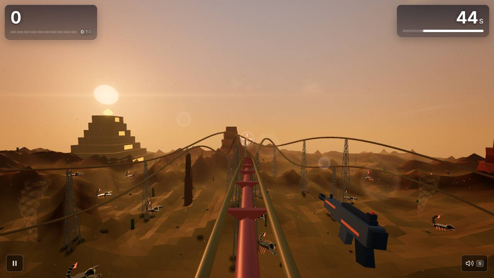
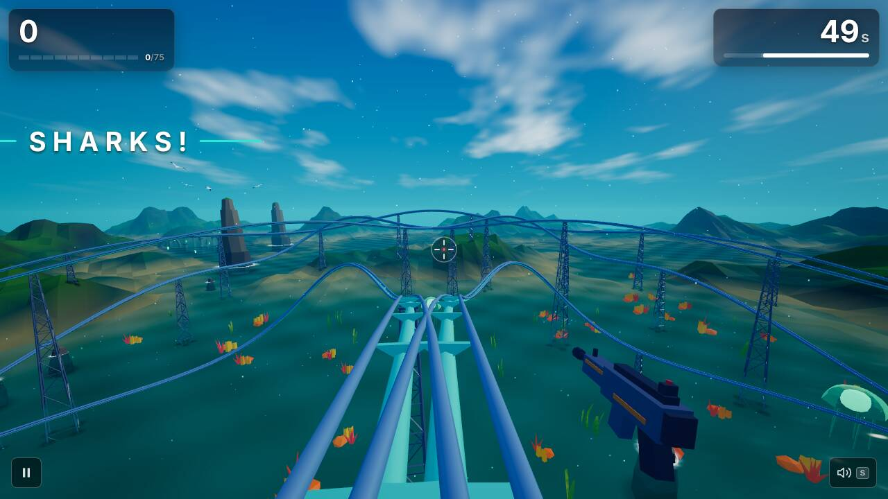
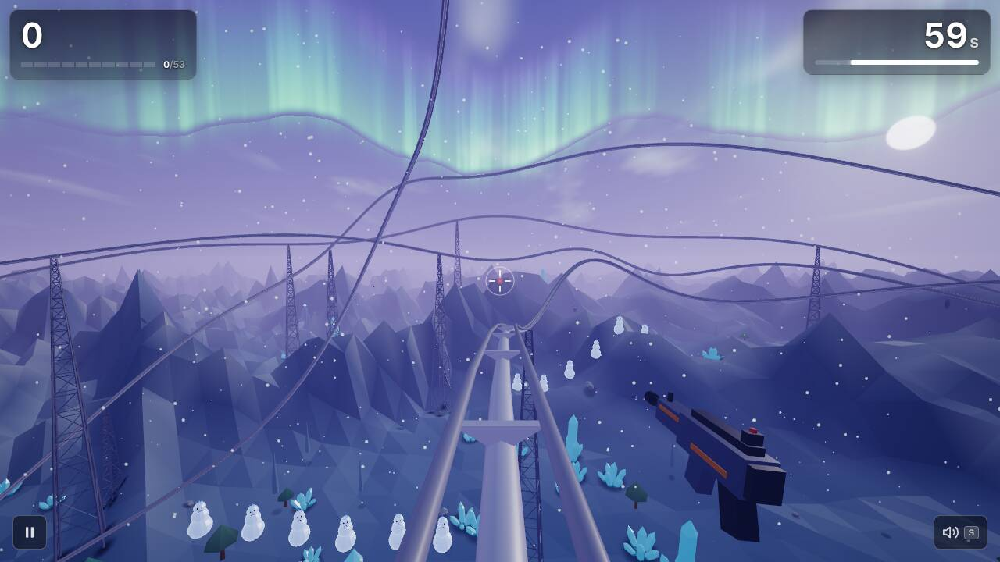
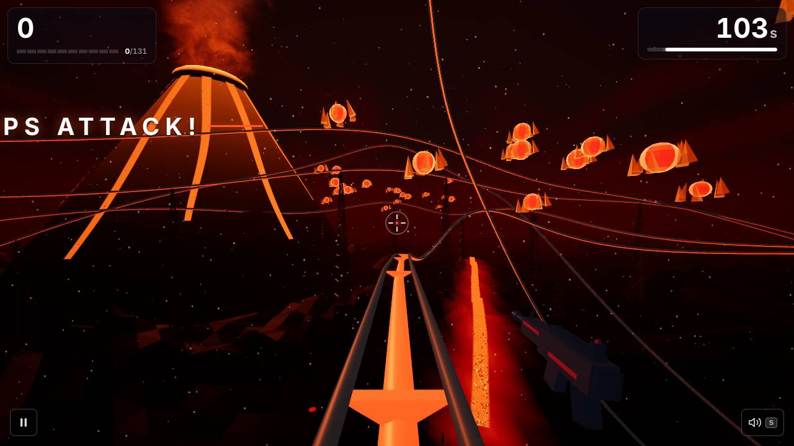

# ShooterCoaster weekly report — 2026-W44 (Mon 26 Oct – Sun 1 Nov)

## Headline

Runs now have an arcade shape: combo tiers with a FRENZY slow-mo, waves that announce themselves, bosses (the Golden Blimp in Theme Park, the Kraken in Ocean), weapon pickups, a Daily Run, a real pause menu, and a Share button on the results screen.

## Play it

https://scoaster.com

## What's new for players

- **Combos matter.** 1× / 2× / 3× / 5× tiers, a "COMBO LOST" shake and a FRENZY slow-mo at the top tier ([#194](https://github.com/alexbelyeu/shooterCoaster/pull/194)). Fireworks go off over the Theme Park midway on kill streaks ([#222](https://github.com/alexbelyeu/shooterCoaster/pull/222)).
- **Waves arrive.** Enemies fly in on formations (V, line, school, spiral, ring) with a one-second warning banner ([#197](https://github.com/alexbelyeu/shooterCoaster/pull/197)); every enemy type now dies its own way ([#227](https://github.com/alexbelyeu/shooterCoaster/pull/227)).
- **Boss finales.** The Golden Blimp ends Theme Park ([#219](https://github.com/alexbelyeu/shooterCoaster/pull/219)); the Kraken's tentacles and eye end Ocean ([#263](https://github.com/alexbelyeu/shooterCoaster/pull/263)).
- **Weapon pickups** on the track: spread, rapid and piercing guns for 10 s ([#266](https://github.com/alexbelyeu/shooterCoaster/pull/266)).
- **Daily Run:** one seeded run per day with its own best and streak ([#265](https://github.com/alexbelyeu/shooterCoaster/pull/265)).
- **Pause that really pauses**, with a styled menu and a Ready/GO resume ([#233](https://github.com/alexbelyeu/shooterCoaster/pull/233)); **Settings** for graphics quality, volumes, screen shake and reduced motion ([#239](https://github.com/alexbelyeu/shooterCoaster/pull/239)).
- **Share button** on the results screen ([#253](https://github.com/alexbelyeu/shooterCoaster/pull/253)).
- **Levels 4 and 5 fixed:** the vertical rail in the sky is gone ([#207](https://github.com/alexbelyeu/shooterCoaster/pull/207)), Antarctica's enemies spawn beside the track and are readable ([#208](https://github.com/alexbelyeu/shooterCoaster/pull/208)), pines are blue-green instead of black ([#238](https://github.com/alexbelyeu/shooterCoaster/pull/238)), and Inferno's volcano, lava and track glow in the dark ([#218](https://github.com/alexbelyeu/shooterCoaster/pull/218)).
- **Looks:** soft contact shadows under props ([#155](https://github.com/alexbelyeu/shooterCoaster/pull/155)), ambient particles per biome ([#245](https://github.com/alexbelyeu/shooterCoaster/pull/245)), rails and towers that stay visible at distance ([#270](https://github.com/alexbelyeu/shooterCoaster/pull/270)), glossy enemies that reflect the sky ([#282](https://github.com/alexbelyeu/shooterCoaster/pull/282)), a title fly-by ([#167](https://github.com/alexbelyeu/shooterCoaster/pull/167)).
- **Fixes:** FRENZY slow-mo ends at results ([#295](https://github.com/alexbelyeu/shooterCoaster/pull/295)), music tracks crossfade on the beat ([#290](https://github.com/alexbelyeu/shooterCoaster/pull/290)), the portrait gun stays clear of the combo meter ([#276](https://github.com/alexbelyeu/shooterCoaster/pull/276)), waves continue after Resume ([#221](https://github.com/alexbelyeu/shooterCoaster/pull/221)).

## Screenshots

Taken by the smoke test at the start of each ride (score 0, so no enemies have been hit yet).

## Listen

The new score engine and arcade sound landed this week ([#234](https://github.com/alexbelyeu/shooterCoaster/pull/234), [#244](https://github.com/alexbelyeu/shooterCoaster/pull/244), [#242](https://github.com/alexbelyeu/shooterCoaster/pull/242)). Renders (raw links):

- [Theme Park score](https://raw.githubusercontent.com/alexbelyeu/shooterCoaster/main/docs/audio/renders/scrim-music-level1.mp3), [Desert](https://raw.githubusercontent.com/alexbelyeu/shooterCoaster/main/docs/audio/renders/scrim-music-level2.mp3), [Ocean](https://raw.githubusercontent.com/alexbelyeu/shooterCoaster/main/docs/audio/renders/scrim-music-level3.mp3), [Antarctica](https://raw.githubusercontent.com/alexbelyeu/shooterCoaster/main/docs/audio/renders/scrim-music-level4.mp3), [Inferno](https://raw.githubusercontent.com/alexbelyeu/shooterCoaster/main/docs/audio/renders/scrim-music-level5.mp3): first arcade scores per level.
- [Title](https://raw.githubusercontent.com/alexbelyeu/shooterCoaster/main/docs/audio/renders/scrim-music-title.mp3) and [Results](https://raw.githubusercontent.com/alexbelyeu/shooterCoaster/main/docs/audio/renders/scrim-music-results.mp3) themes.
- [Level 1 SFX sheet](https://raw.githubusercontent.com/alexbelyeu/shooterCoaster/main/docs/audio/renders/scrim-sfx-sheet-level1.mp3) and [full combat mix](https://raw.githubusercontent.com/alexbelyeu/shooterCoaster/main/docs/audio/renders/scrim-mix-level1.mp3): the new arcade gun, kill and boss sounds over the music.
- [Baseline of the old sound](https://raw.githubusercontent.com/alexbelyeu/shooterCoaster/main/docs/audio/renders/baseline-music-level1.mp3) for comparison, and the [drum / groove / melodic palette demos](https://raw.githubusercontent.com/alexbelyeu/shooterCoaster/main/docs/audio/renders/palette-groove.mp3).

Waiting for your pick: [#301 Listen: pick the title and Theme Park themes](https://github.com/alexbelyeu/shooterCoaster/issues/301) (three options each, from PR [#300](https://github.com/alexbelyeu/shooterCoaster/pull/300), still in QA).

## Under the hood

- **Audio:** Scrimshaw score engine ported behind `?audio=scrim` and checked against the original ([#234](https://github.com/alexbelyeu/shooterCoaster/pull/234)); baked arcade SFX with a voice budget ([#244](https://github.com/alexbelyeu/shooterCoaster/pull/244)); `audio:render` / `audio:check` tooling ([#230](https://github.com/alexbelyeu/shooterCoaster/pull/230)); one SFX lifecycle ([#281](https://github.com/alexbelyeu/shooterCoaster/pull/281)).
- **Perf:** Tone.js now loads on the first tap in its own chunk ([#269](https://github.com/alexbelyeu/shooterCoaster/pull/269)); Desert crows and scorpions are batched ([#205](https://github.com/alexbelyeu/shooterCoaster/pull/205)); the smoke has per-level draw-call and triangle ceilings ([#258](https://github.com/alexbelyeu/shooterCoaster/pull/258)); graphics presets and adaptive resolution ([#239](https://github.com/alexbelyeu/shooterCoaster/pull/239)).
- **Site:** real 404s, headers, manifest, icons, share card and a Lighthouse gate ([#275](https://github.com/alexbelyeu/shooterCoaster/pull/275)); indexable about text and JSON-LD ([#255](https://github.com/alexbelyeu/shooterCoaster/pull/255)); a portal build for itch.io / Newgrounds / CrazyGames ([#251](https://github.com/alexbelyeu/shooterCoaster/pull/251)); `/go/<campaign>` landing paths pinned ([#261](https://github.com/alexbelyeu/shooterCoaster/pull/261)); the gameplay clip renderer ([#202](https://github.com/alexbelyeu/shooterCoaster/pull/202)).
- **Cleanup:** the legacy v1 game and dead code were removed ([#286](https://github.com/alexbelyeu/shooterCoaster/pull/286); `main` is about 70k lines lighter than a week ago).
- **Studio:** auto-merge sweep every 10 minutes ([#240](https://github.com/alexbelyeu/shooterCoaster/pull/240)); verify re-runs on `main` after every merge ([#226](https://github.com/alexbelyeu/shooterCoaster/pull/226)); token-efficiency changes and a daily builder cap ([#298](https://github.com/alexbelyeu/shooterCoaster/pull/298)).

## Players

From the Marketer's W44 baseline ([PR #310](https://github.com/alexbelyeu/shooterCoaster/pull/310), not merged yet): 37 visitors and 43 page views this week (W43: 31 and 47), 100% direct traffic, no posts yet. Mobile was 24% of visitors (W43: 29%). There were 8 level starts and 3 completes. Only 1 of 9 mobile visitors started a level, against 6 of 28 on desktop.

Waiting for Alex: [#102](https://github.com/alexbelyeu/shooterCoaster/issues/102) three.js Showcase post (the Marketer says go today, after a one-minute phone and desktop check), [#308](https://github.com/alexbelyeu/shooterCoaster/issues/308) Reddit pair for 7–8 Nov, [#274](https://github.com/alexbelyeu/shooterCoaster/issues/274) Search Console and Bing setup.

## Health

- **Merged:** 54 PRs with code or tooling changes, plus the decision-log folds and docs. **Reverted:** 0. Sent back to Fix: 22 Fix runs in the ledger (I did not count which PRs they covered).
- **Today's `main` is red in CI** and has been since 10:43 UTC: GitHub's `ubuntu-latest` moved to Ubuntu 26.04 and `playwright install --with-deps` refuses it ([#311](https://github.com/alexbelyeu/shooterCoaster/issues/311), P1, ready for a builder; the fix is to pin `ubuntu-24.04`). Production smoke issue [#297](https://github.com/alexbelyeu/shooterCoaster/issues/297) is still open; the Maintainer reads it as slow-runner flakes, with [#305](https://github.com/alexbelyeu/shooterCoaster/issues/305) and PR [#312](https://github.com/alexbelyeu/shooterCoaster/pull/312) as the fix. Deploys of the live game are not affected by this.
- **My `npm run verify` on `main` (8e66045) passed:** 685 unit tests, build, bundle budget, Lighthouse (mobile and desktop: SEO 100, Accessibility 100, Best Practices 100; Performance 29 mobile / 59 desktop, printed only) and the full smoke. Note this sandbox renders in software at about 0.4 frames per second, so frame times below are not real-device numbers.
- **Bundle:** 562 KB gzip total JS (budget 700); largest chunk 184 KB (budget 260); startup JS 472 KB.

| Level | Draw calls | Triangles | Enemies on screen / readable |
|---|---:|---:|---|
| 1 Theme Park | 84 | 174k | 19 / 19 |
| 2 Desert | 110 | 201k | 36 / 29 |
| 3 Ocean | 71 | 162k | 8 / 8 |
| 4 Antarctica | 394 | 207k | 15 / 15 |
| 5 Inferno | 295 | 152k | 36 / 21 |

Antarctica (394) and Inferno (295) are over the 250 draw-call bar in VISION ([#260](https://github.com/alexbelyeu/shooterCoaster/issues/260), open). Open blockers: `agent:prod-broken` [#297](https://github.com/alexbelyeu/shooterCoaster/issues/297); `agent:blocked` [#305](https://github.com/alexbelyeu/shooterCoaster/issues/305), [#303](https://github.com/alexbelyeu/shooterCoaster/issues/303), [#302](https://github.com/alexbelyeu/shooterCoaster/issues/302), [#272](https://github.com/alexbelyeu/shooterCoaster/issues/272), [#40](https://github.com/alexbelyeu/shooterCoaster/issues/40).

## Token use

Weighted tokens from the ledger for 26 Oct 04:00 UTC to 2 Nov 04:59 UTC: **211.7M over 158 runs**. Last week's report covered only 24–26 Oct (25.2M, 22 runs), so there is no like-for-like trend yet.

| Role | Runs | Total |
|---|---:|---:|
| Builders | 25 | 150.1M |
| QA (on label) | 101 | 34.4M |
| Maintainer | 5 | 10.4M |
| Fix (on label) | 22 | 7.0M |
| Director | 1 | 5.1M |
| QA (scheduled) | 2 | 2.8M |
| Marketer | 1 | 1.5M |
| Reporter | 1 | 0.4M |

Most expensive PRs (builder + QA + fix, split evenly when a run covered several):

| PR | Weighted tokens |
|---|---:|
| #239 settings / graphics quality | 8.1M |
| #234 Scrimshaw engine port | 6.5M |
| #233 real pause | 6.1M |
| #281 one SFX lifecycle | 6.0M |
| #244 arcade SFX | 6.0M |
| #252 local leaderboard (closed unmerged) | 5.9M |
| #245 biome particles | 5.7M |
| #230 audio render tooling | 5.5M |
| #269 lazy Tone.js | 5.3M |
| #266 weapon pickups | 5.2M |

Builders are 71% of spend. The top three are all cross-cutting features (settings across the store, UI and renderer; an engine port with parity tests; a pause that touches every clock). I did not pull per-run turn counts, so I can't say how many rounds each was sent back. The leaderboard PR #252 cost 5.9M and was closed without merging. Scheduled QA is a small share, but 101 on-label QA runs add up to 34M.

## Next up

Roadmap: M2 (epics [#176](https://github.com/alexbelyeu/shooterCoaster/issues/176) arcade loop and [#177](https://github.com/alexbelyeu/shooterCoaster/issues/177) finales and spectacle) is in progress. Top `agent:ready` issues:

1. [#311](https://github.com/alexbelyeu/shooterCoaster/issues/311) (P1): fix red CI by pinning `ubuntu-24.04`.
2. [#299](https://github.com/alexbelyeu/shooterCoaster/issues/299) (P1): auto-merge hands conflicting approved PRs back to Fix.
3. [#309](https://github.com/alexbelyeu/shooterCoaster/issues/309) (P2): vertical gameplay clip for Shorts / Reels / TikTok. Also queued at P2: [#307](https://github.com/alexbelyeu/shooterCoaster/issues/307) portal zip as a CI artifact and [#260](https://github.com/alexbelyeu/shooterCoaster/issues/260) draw calls on levels 4–5.

In QA now: [#300](https://github.com/alexbelyeu/shooterCoaster/pull/300) title and Theme Park themes, [#304](https://github.com/alexbelyeu/shooterCoaster/pull/304) share menu, [#296](https://github.com/alexbelyeu/shooterCoaster/pull/296) clip tooling, [#310](https://github.com/alexbelyeu/shooterCoaster/pull/310) marketing docs.

## Steer me

Edit `docs/agents/STEERING.md` on GitHub, or open an issue labelled `steering`. Setting `pause: true` there stops every scheduled run.
