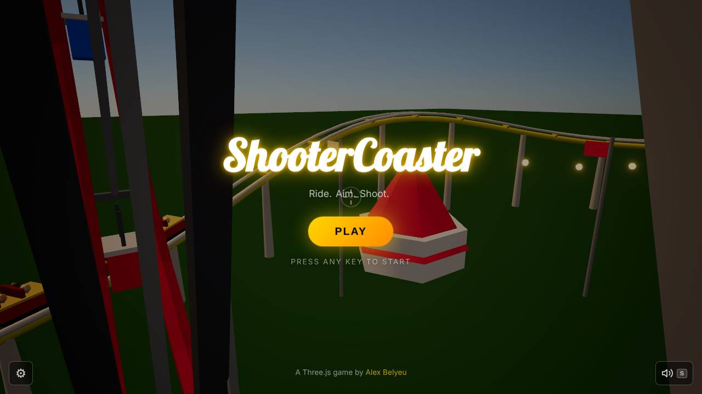
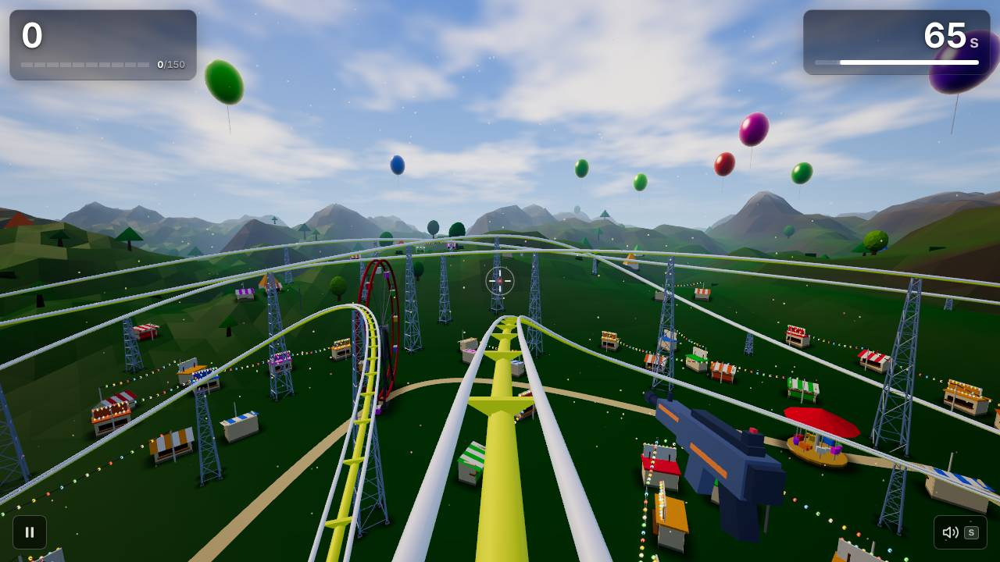
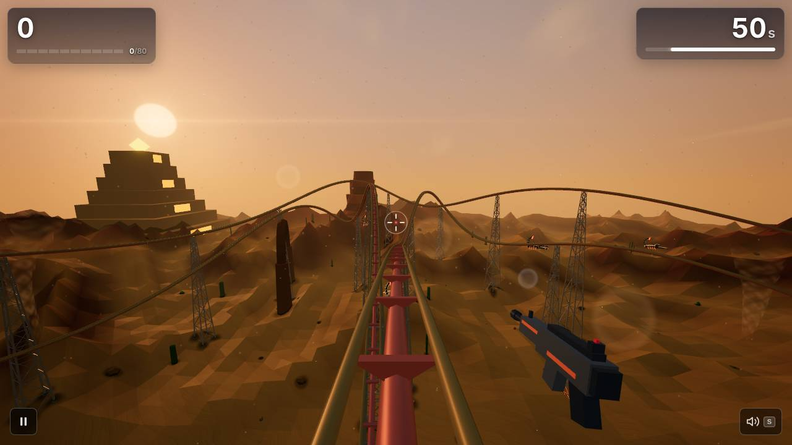
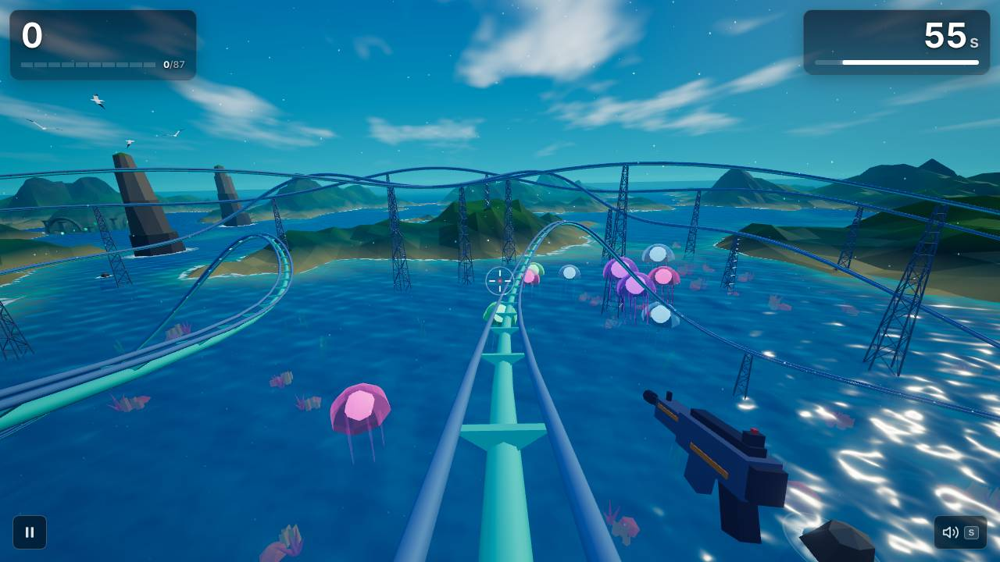
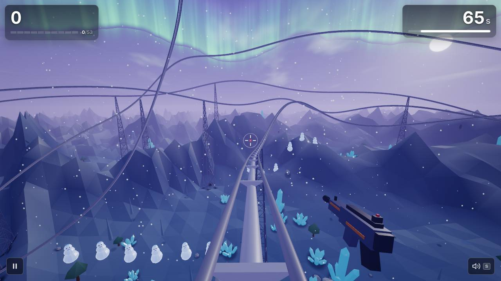
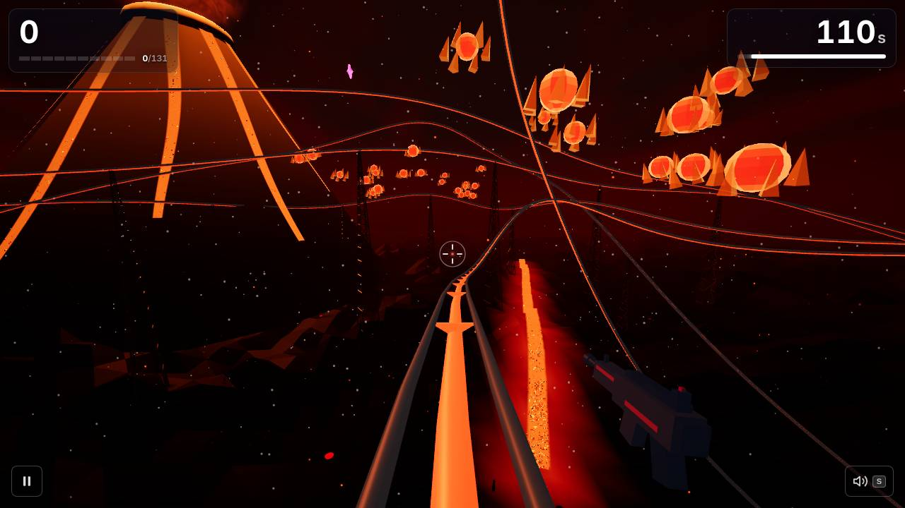

# ShooterCoaster weekly report — 2026-W45 (Mon 2 Nov – Sun 8 Nov)

## Headline

Levels 2 and 4 now end with bosses: the Giant Scorpion rises from the Desert dunes, the Yeti hurls snowballs you must shoot down in Antarctica, the Ocean's water finally reads as water, and the title screen has a coaster riding round the park to a beat-locked camera.

## Play it

https://scoaster.com

## What's new for players

- **The Giant Scorpion ends the Desert** ([#348](https://github.com/alexbelyeu/shooterCoaster/pull/348)): a dune heaves, it bursts out, lunges every 4 s, and you take its claws and tail apart before the stinger.
- **The Yeti ends Antarctica** ([#441](https://github.com/alexbelyeu/shooterCoaster/pull/441)): it climbs ridges, throws snowballs you can shoot for points (or take as a splat on screen), and roars to expose its chest.
- **The Ocean looks like an ocean** ([#430](https://github.com/alexbelyeu/shooterCoaster/pull/430)): sun glitter, wave motion, shallows and a real horizon. Jellyfish and sharks now float beside the track ahead of you ([#343](https://github.com/alexbelyeu/shooterCoaster/pull/343)).
- **A living title screen** ([#423](https://github.com/alexbelyeu/shooterCoaster/pull/423)): a coaster rides a loop round the park, camera cuts land on the music's bars, the logo and menu animate, and attract mode kicks in after 30 s idle. The page paints a poster from the first frame ([#420](https://github.com/alexbelyeu/shooterCoaster/pull/420)).
- **Your picked music is in the game** ([#386](https://github.com/alexbelyeu/shooterCoaster/pull/386), [#421](https://github.com/alexbelyeu/shooterCoaster/pull/421)): Neon Marquee, Midway Rush, Dune Rider, Lagoon Run, Aurora, Hellgate. The score now has intensity layers (base, drums, lead, FRENZY) that follow your combo ([#347](https://github.com/alexbelyeu/shooterCoaster/pull/347)); Tone.js is gone and the one score engine plays everything ([#431](https://github.com/alexbelyeu/shooterCoaster/pull/431)).
- **A leaderboard**: local top 10 per level with arcade initials ([#346](https://github.com/alexbelyeu/shooterCoaster/pull/346)) and an online World top 10 backed by Vercel + Supabase, falling back to the local board ([#383](https://github.com/alexbelyeu/shooterCoaster/pull/383)).
- **Sharing:** the results screen's Share button offers a menu on desktop ([#304](https://github.com/alexbelyeu/shooterCoaster/pull/304)) and a score card image (1200×630, or 1080×1920 for phones) with the native share sheet on phones ([#368](https://github.com/alexbelyeu/shooterCoaster/pull/368)).
- **Fixes:** level 1's organ riff plays at base intensity ([#427](https://github.com/alexbelyeu/shooterCoaster/pull/427)); one NaN pixel can no longer black out the title through Bloom ([#345](https://github.com/alexbelyeu/shooterCoaster/pull/345)).

## Screenshots

Taken by the smoke test at the start of each ride (score 0, so nothing has been shot yet).

## Listen

Changed this week: the level 1–5 scores and the mixed combat renders, the title and results themes, and the new intensity layers. Raw links:

- Level scores: [Theme Park](https://raw.githubusercontent.com/alexbelyeu/shooterCoaster/main/docs/audio/renders/music-level1.mp3), [Desert](https://raw.githubusercontent.com/alexbelyeu/shooterCoaster/main/docs/audio/renders/music-level2.mp3), [Ocean](https://raw.githubusercontent.com/alexbelyeu/shooterCoaster/main/docs/audio/renders/music-level3.mp3), [Antarctica](https://raw.githubusercontent.com/alexbelyeu/shooterCoaster/main/docs/audio/renders/music-level4.mp3), [Inferno](https://raw.githubusercontent.com/alexbelyeu/shooterCoaster/main/docs/audio/renders/music-level5.mp3): your picked themes.
- Layers: [Theme Park base](https://raw.githubusercontent.com/alexbelyeu/shooterCoaster/main/docs/audio/renders/music-level1-base.mp3) versus [full](https://raw.githubusercontent.com/alexbelyeu/shooterCoaster/main/docs/audio/renders/music-level1-full.mp3) versus [FRENZY](https://raw.githubusercontent.com/alexbelyeu/shooterCoaster/main/docs/audio/renders/music-level1-frenzy.mp3).
- [Title](https://raw.githubusercontent.com/alexbelyeu/shooterCoaster/main/docs/audio/renders/music-title.mp3) and [Results](https://raw.githubusercontent.com/alexbelyeu/shooterCoaster/main/docs/audio/renders/music-results.mp3) themes.
- Combat mixes with sound effects over the score: [level 1](https://raw.githubusercontent.com/alexbelyeu/shooterCoaster/main/docs/audio/renders/mix-level1.mp3) and levels 2–5 beside it (`mix-level2.mp3` … `mix-level5.mp3`).

No `Listen:` issues are waiting for your pick.

## Under the hood

- **Audio:** Tone.js removed, one score engine ([#431](https://github.com/alexbelyeu/shooterCoaster/pull/431)); intensity layers with a lint that checks layers only add ([#347](https://github.com/alexbelyeu/shooterCoaster/pull/347), [#427](https://github.com/alexbelyeu/shooterCoaster/pull/427)).
- **Perf:** same-material enemy parts are merged, so Antarctica fell from 394 draw calls to 178 and Inferno from 295 to 116, both under the 250 bar ([#350](https://github.com/alexbelyeu/shooterCoaster/pull/350)). The title poster, a lazy level chunk and new startup budgets ([#420](https://github.com/alexbelyeu/shooterCoaster/pull/420)).
- **Telemetry:** real-player errors, WebGL context loss and frame times per level, watched by the studio ([#412](https://github.com/alexbelyeu/shooterCoaster/pull/412)).
- **CI:** the smoke is sharded and has a runtime budget ([#364](https://github.com/alexbelyeu/shooterCoaster/pull/364)); PRs run rendering and integration checks while the deep checks run nightly ([#411](https://github.com/alexbelyeu/shooterCoaster/pull/411)); docs-only PRs skip the smoke ([#409](https://github.com/alexbelyeu/shooterCoaster/pull/409)); a fast production health check runs after every deploy ([#355](https://github.com/alexbelyeu/shooterCoaster/pull/355)); the merge gate runs after every CI run ([#425](https://github.com/alexbelyeu/shooterCoaster/pull/425)) and hands conflicting approved PRs back to Fix ([#341](https://github.com/alexbelyeu/shooterCoaster/pull/341), [#363](https://github.com/alexbelyeu/shooterCoaster/pull/363)).
- **Studio:** a watchdog files its own problems ([#370](https://github.com/alexbelyeu/shooterCoaster/pull/370)); milestone progress on the status page ([#377](https://github.com/alexbelyeu/shooterCoaster/pull/377)); builder token budgets ([#417](https://github.com/alexbelyeu/shooterCoaster/pull/417), [#433](https://github.com/alexbelyeu/shooterCoaster/pull/433)).
- **Dev tools:** an enemy turntable renders every enemy and boss from every side ([#387](https://github.com/alexbelyeu/shooterCoaster/pull/387)); the clip tool takes any level, plus a vertical 720×1280 level-1 clip for Shorts, Reels and TikTok ([#296](https://github.com/alexbelyeu/shooterCoaster/pull/296), [#395](https://github.com/alexbelyeu/shooterCoaster/pull/395)).
- **Size:** 51 commits on `main`; 378 files changed, +20,216 / −4,828 lines.

## Players

From the Marketer's W45 metrics (`docs/marketing/metrics/2026-W45.md`): **28 visitors** (W44: 37) and **65 page views** (W44: 43), all direct traffic except one view from github.com. **Nothing was posted this week**, so this is a second baseline week, not the launch week it was meant to be. Mobile was 1 of 28 visitors.

All 31 level starts and 11 completes came from one Mac browser on four days, which looks like your own playing from a browser not marked internal. The other 23 visitors started no level. Opening https://scoaster.com/?internal=1 once on that browser stops this; #446 adds a Settings toggle.

Waiting for you (`needs-alex`): [#102](https://github.com/alexbelyeu/shooterCoaster/issues/102) three.js Showcase post (this week, a weekday morning US time), [#308](https://github.com/alexbelyeu/shooterCoaster/issues/308) Reddit posts to follow it, [#274](https://github.com/alexbelyeu/shooterCoaster/issues/274) verify scoaster.com in Google Search Console and Bing.

## Health

- **Merged:** 50 PRs (code, tooling, docs and decision-log folds). **Reverted:** 0. The ledger shows 9 Fix-on-label runs; I did not count which PRs they covered.
- **`main` is green:** CI on `041625b` passes every shard, Lighthouse and the `verify` gate; the production smoke passed at 10:46 UTC today. No open `agent:prod-broken` issue. Open `agent:blocked`: [#329](https://github.com/alexbelyeu/shooterCoaster/issues/329), [#325](https://github.com/alexbelyeu/shooterCoaster/issues/325), [#324](https://github.com/alexbelyeu/shooterCoaster/issues/324) (all level 6 / title funnel work).
- **My run in this sandbox:** 989 unit tests, build, bundle budgets and Lighthouse passed (SEO, Accessibility, Best Practices all 100; Performance 43 mobile / 59 desktop, printed only). The full smoke here had **7 failing steps** (level 2, 3 and 4 failed on a 10 s click timeout for the share menu's Copy link / Copy image buttons; hidden-pause saw the combo change; the pickup step saw 0 pickups on screen; the phone run's Pause tap timed out). This sandbox draws at about 0.5 s a frame (avg frame 530–670 ms), and the same steps pass in CI's PR shards, so I read these as slow-sandbox timing and not regressions. But I have not proved that: if the nightly production smoke goes red on any of them, treat them as real.
- **Bundle:** 519 KB gzip total JS (budget 630); largest chunk 172 KB (budget 260); startup JS 397 KB (budget 435). Last week: 562 KB total, 184 KB largest, 472 KB startup.

| Level | Draw calls | Triangles |
|---|---:|---:|
| 1 Theme Park | 79 | 173k |
| 2 Desert | 92 | 196k |
| 3 Ocean | 82 | 192k |
| 4 Antarctica | 178 | 207k |
| 5 Inferno | 116 | 152k |

## Token use

Weighted tokens from the ledger for 2 Nov 05:00 UTC to 9 Nov 05:00 UTC: **142.2M over 92 runs**, against 211.7M over 158 runs last week (−33%).

| Role | Runs | Total |
|---|---:|---:|
| Builders | 23 | 87.0M |
| QA (scheduled) | 14 | 27.3M |
| Maintainer | 6 | 11.7M |
| QA (on label) | 37 | 9.1M |
| Director | 1 | 3.1M |
| Fix (on label) | 9 | 2.1M |
| Marketer | 1 | 1.3M |
| Reporter | 1 | 0.5M |

Most expensive refs (builder + QA + fix, split evenly when one run covered several):

| Ref | Weighted tokens |
|---|---:|
| #343 Ocean opening | 12.3M |
| #347 score intensity layers | 7.4M |
| #350 merge same-material enemy parts | 6.6M |
| #368 score card image share | 6.1M |
| #296 clip tooling | 5.1M |
| #386 picked title theme | 4.8M |
| #370 studio-health watchdog | 4.8M |
| #395 vertical clip | 4.7M |
| #348 Desert finale | 4.7M |
| #349 portal zip artifact | 4.6M |

Builders are 61% of spend (71% last week). #343 (Ocean opening) cost almost twice the next PR. I did not pull per-run turns, so I can't say how many rounds it was sent back. [#444](https://github.com/alexbelyeu/shooterCoaster/issues/444) (P1) tracks two builder runs over 5M in 48 h.

## Next up

- **M2 — The arcade loop and the finale:** 34 of 39 issues closed (87%), due 8 Nov, so one day overdue. Its P1 issues are the two epics [#176](https://github.com/alexbelyeu/shooterCoaster/issues/176) and [#177](https://github.com/alexbelyeu/shooterCoaster/issues/177).
- **M3 — Depth and spectacle:** 11 of 42 closed (26%), due 5 Dec, 26 days left. No open P1 issues.

From your playtest notes ([#439](https://github.com/alexbelyeu/shooterCoaster/issues/439)), the Director plans this week: 60-second levels ([#434](https://github.com/alexbelyeu/shooterCoaster/issues/434)), Desert spawn gaps ([#435](https://github.com/alexbelyeu/shooterCoaster/issues/435)), procedurally generated levels ([#437](https://github.com/alexbelyeu/shooterCoaster/issues/437)), a climbing-gym world ([#438](https://github.com/alexbelyeu/shooterCoaster/issues/438)), and a bigger title world ([#436](https://github.com/alexbelyeu/shooterCoaster/issues/436)).

Top `agent:ready` issues now: [#444](https://github.com/alexbelyeu/shooterCoaster/issues/444) (P1) builders' token-heavy runs; [#445](https://github.com/alexbelyeu/shooterCoaster/issues/445) (P2) share line and score card say the World rank; [#446](https://github.com/alexbelyeu/shooterCoaster/issues/446) (P2) a Settings toggle for internal browsers.

## Steer me

Edit `docs/agents/STEERING.md` on GitHub, or open an issue labelled `steering`. Setting `pause: true` there stops every scheduled run.
