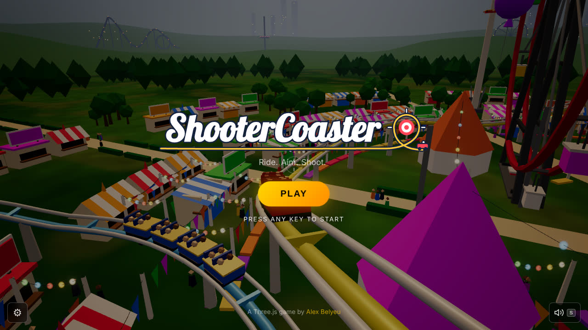
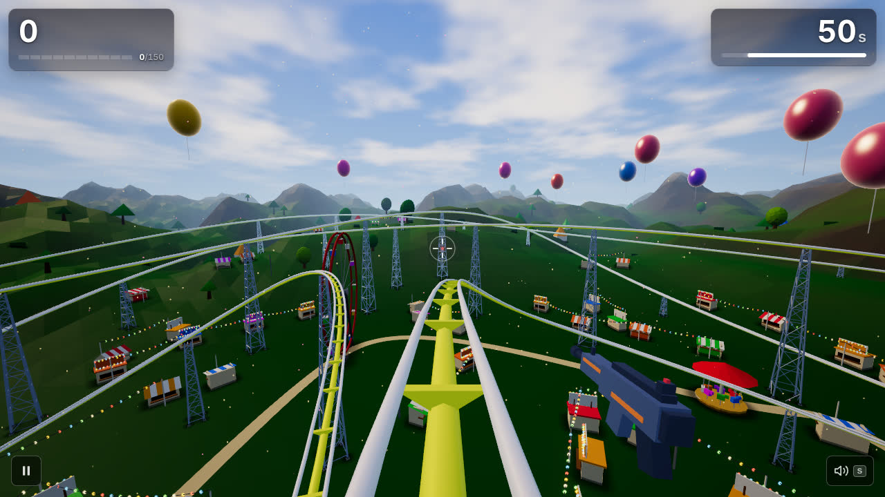
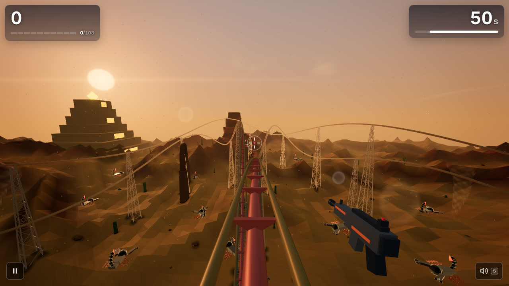
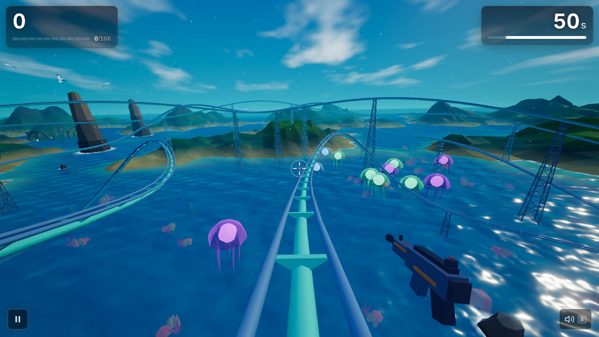
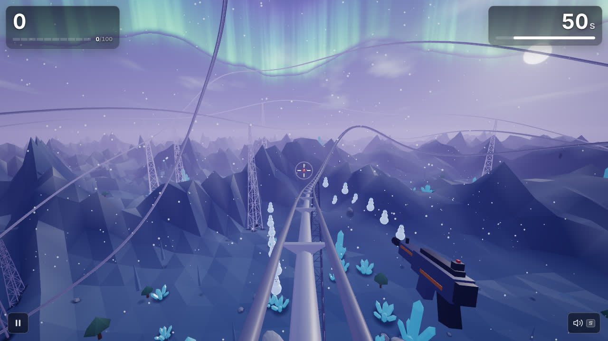
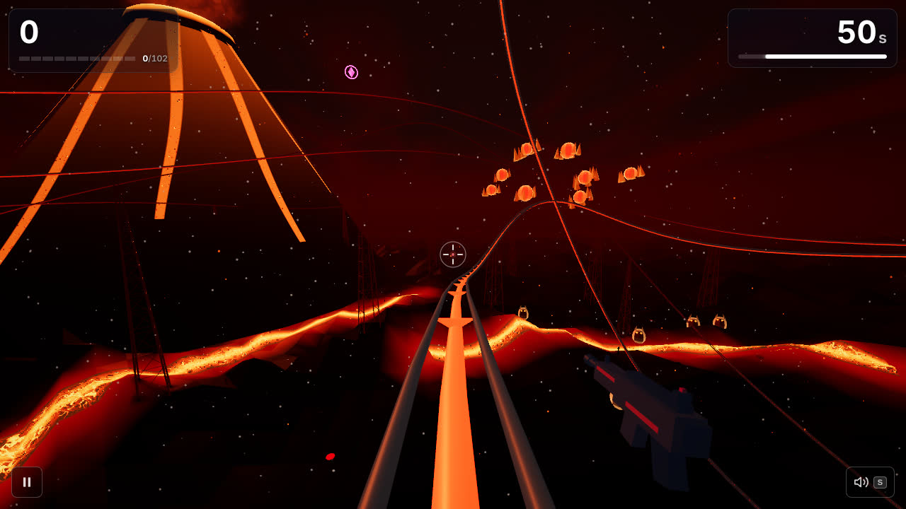
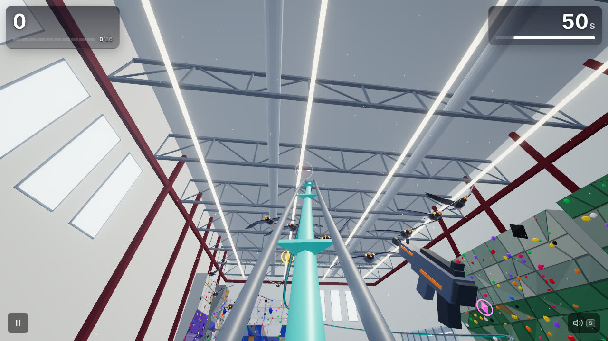

# ShooterCoaster weekly report — 2026-W46 (Mon 9 Nov – Sun 15 Nov)

## Headline

A sixth world is playable: the Climbing Gym, built from your own blockout, with climbers, rats, dust bunnies and lanternflies on its walls and the Medusa rising out of the Starr; and every run in every world is now exactly 60 seconds, ending on a boss (Inferno's Magma Titan is new).

## Play it

https://scoaster.com

## What's new for players

- **Level 6, the Climbing Gym** ([#526](https://github.com/alexbelyeu/shooterCoaster/pull/526), [#546](https://github.com/alexbelyeu/shooterCoaster/pull/546)): your blockout as the hall, an authored track through its four ride moments; the Tree is a barked trunk on roots, the walls rugged grimy panels ([#578](https://github.com/alexbelyeu/shooterCoaster/pull/578)), and the Flame burns with fire up its faces and rising embers ([#581](https://github.com/alexbelyeu/shooterCoaster/pull/581)). It unlocks after Inferno.
- **The Medusa of the Starr** ends the gym ([#556](https://github.com/alexbelyeu/shooterCoaster/pull/556)): the star's points glow and its hub opens, she rises out, and her beaded toy snakes strike at you in turns before the crown snake.
- **Gym enemies:** the Climber, a toy figurine that climbs a wall and pops off in chalk ([#479](https://github.com/alexbelyeu/shooterCoaster/pull/479)); New York rats and dust bunnies ([#523](https://github.com/alexbelyeu/shooterCoaster/pull/523)); the spotted lanternfly, which hops, glides and flashes red on the walls ([#576](https://github.com/alexbelyeu/shooterCoaster/pull/576)).
- **The Magma Titan ends Inferno** ([#542](https://github.com/alexbelyeu/shooterCoaster/pull/542)): the final eruption, then it climbs out of a lava river and wades after you; its cracks glow white-hot as it weakens. Lava rivers now cross the ride as channels in the ground, not a glowing wall ([#559](https://github.com/alexbelyeu/shooterCoaster/pull/559)). Every world now has a boss.
- **Every run is 60 seconds** ([#473](https://github.com/alexbelyeu/shooterCoaster/pull/473)): waves through the first 45 s, the boss at 40 s, the fight ends the run. Old long-run scores leave the local and World boards without a wipe ([#571](https://github.com/alexbelyeu/shooterCoaster/pull/571)).
- **Enemies appear where you're looking** ([#470](https://github.com/alexbelyeu/shooterCoaster/pull/470), [#491](https://github.com/alexbelyeu/shooterCoaster/pull/491), [#580](https://github.com/alexbelyeu/shooterCoaster/pull/580)): waves are placed in the camera's view when they arrive and spread over their window; the Desert's opening scorpions stand beside the track.
- **A bigger title world** ([#492](https://github.com/alexbelyeu/shooterCoaster/pull/492), [#572](https://github.com/alexbelyeu/shooterCoaster/pull/572)): the park fills the frame with a midway, crowds, rides, a second coaster and a lake, and beyond it hill ridges, ride silhouettes, skyline lights and horizon fog. The new loop logo is on the title, poster, score card and share card ([#534](https://github.com/alexbelyeu/shooterCoaster/pull/534), [#537](https://github.com/alexbelyeu/shooterCoaster/pull/537)).
- **The crow as a character** ([#573](https://github.com/alexbelyeu/shooterCoaster/pull/573)): tapered body, fingered wings, hooked beak, an eye glint, and it flinches when hit. The far track now thins and hazes with distance ([#560](https://github.com/alexbelyeu/shooterCoaster/pull/560)).
- **Sharing and settings:** your share line and score card say your World rank ([#562](https://github.com/alexbelyeu/shooterCoaster/pull/562)); Settings has an "Internal device" toggle so your own plays aren't tracked ([#564](https://github.com/alexbelyeu/shooterCoaster/pull/564)).
- **Fix:** the results screen always shows when a run ends during a screen fade ([#563](https://github.com/alexbelyeu/shooterCoaster/pull/563)).

## Screenshots

Taken by the smoke test at the start of each ride.

## Listen

New this week: three theme options for the Climbing Gym ([#567](https://github.com/alexbelyeu/shooterCoaster/pull/567)), each as its first 30 s and 20 s across the loop seam. **Waiting for your pick in [#565](https://github.com/alexbelyeu/shooterCoaster/issues/565)**; until then level 6 has no default score.

- **Chalk Up** (D major, 174 BPM, supersaw hook with claps; the most direct): [30 s](https://raw.githubusercontent.com/alexbelyeu/shooterCoaster/main/docs/audio/renders/theme-level6-chalkup.mp3) · [seam](https://raw.githubusercontent.com/alexbelyeu/shooterCoaster/main/docs/audio/renders/theme-level6-chalkup-seam.mp3)
- **Uptown Local** (E minor, 172 BPM, street-funk slap bass; the grimiest): [30 s](https://raw.githubusercontent.com/alexbelyeu/shooterCoaster/main/docs/audio/renders/theme-level6-subway.mp3) · [seam](https://raw.githubusercontent.com/alexbelyeu/shooterCoaster/main/docs/audio/renders/theme-level6-subway-seam.mp3)
- **Lanternfly Hop** (E♭ major, 176 BPM, hopping xylophone cartoon chase; the funniest): [30 s](https://raw.githubusercontent.com/alexbelyeu/shooterCoaster/main/docs/audio/renders/theme-level6-lanternfly.mp3) · [seam](https://raw.githubusercontent.com/alexbelyeu/shooterCoaster/main/docs/audio/renders/theme-level6-lanternfly-seam.mp3)

In the game: `https://scoaster.com/?theme=chalkup` (or `subway`, `lanternfly`), then play the Climbing Gym.

## Under the hood

- **Level kit:** `npm run new-world` scaffolds a new world with every registration and gate ([#551](https://github.com/alexbelyeu/shooterCoaster/pull/551)).
- **Perf tooling:** `?perf=1` hitch recorder with a Copy report button, shaders compiled after warm-up counted on every ride, a CPU-throttled smoke and long-frame telemetry ([#540](https://github.com/alexbelyeu/shooterCoaster/pull/540)). Your MacBook report from it became #596 / #597 (below).
- **Lint:** ESLint now runs in `verify` and CI, with repo rules: no `Math.random` outside cosmetic jitter, `api/` imports nothing from `src/` ([#482](https://github.com/alexbelyeu/shooterCoaster/pull/482)), and no allocations in per-frame code, hard rule 8 ([#569](https://github.com/alexbelyeu/shooterCoaster/pull/569)).
- **Engine:** one owner for slow-mo time scale; old composer render targets freed on a quality change ([#500](https://github.com/alexbelyeu/shooterCoaster/pull/500)).
- **Smoke and CI:** a nightly pacing step measures time with nothing to shoot per level ([#467](https://github.com/alexbelyeu/shooterCoaster/pull/467)); shard budgets scale with runner speed and warn instead of failing ([#443](https://github.com/alexbelyeu/shooterCoaster/pull/443), [#489](https://github.com/alexbelyeu/shooterCoaster/pull/489)); deterministic level steps ([#531](https://github.com/alexbelyeu/shooterCoaster/pull/531)); slow-runner fixes and Ready waits for the level chunk ([#574](https://github.com/alexbelyeu/shooterCoaster/pull/574)); lighter portal smoke ([#488](https://github.com/alexbelyeu/shooterCoaster/pull/488)); Chromium installed without apt ([#508](https://github.com/alexbelyeu/shooterCoaster/pull/508)).
- **Studio:** watchdog fixes ([#466](https://github.com/alexbelyeu/shooterCoaster/pull/466), [#490](https://github.com/alexbelyeu/shooterCoaster/pull/490), [#497](https://github.com/alexbelyeu/shooterCoaster/pull/497)); builders measure their own context and ship a slice of multi-feature issues ([#498](https://github.com/alexbelyeu/shooterCoaster/pull/498)).
- **Size:** 55 commits on `main`; 350 files changed, +19,252 / −1,959 lines.

## Players

From the Marketer's W46 metrics (`docs/marketing/metrics/2026-W46.md`): **26 visitors** (W45: 28, −7%) and **42 page views** (W45: 65). Still almost all direct; the **first Google search visit** arrived on 12 Nov. **Nothing was posted again**, so this is a third baseline week, but it is the first with **players who aren't you**: four people (France, Sweden, the Netherlands, China) started a level. 19% of visitors were on a phone or tablet (W45: 4%). 22 level starts, 16 completes, and the first 2 `share` events.

Waiting for you (`needs-alex`):
- [#610](https://github.com/alexbelyeu/shooterCoaster/issues/610) **Decide what the first public post waits for** — reply A, B or C. The Marketer recommends A: post to the three.js Showcase the first weekday after the ride-stall fix #596 merges.
- [#565](https://github.com/alexbelyeu/shooterCoaster/issues/565) pick the Climbing Gym theme (Listen above).
- [#308](https://github.com/alexbelyeu/shooterCoaster/issues/308) Reddit posts, waiting on #610.

## Health

- **Merged:** 55 PRs (code, tooling, docs and decision-log folds). **Sent back by QA:** 10 of them, 11 rounds in all ([#546](https://github.com/alexbelyeu/shooterCoaster/pull/546) went back twice). **Reverted:** 0.
- **CI:** 65 of 69 completed PR runs of CI passed (94%). The nightly production smoke failed on 9, 10 and 15 Nov and passed on 11–14 and 16 Nov; every post-deploy production check today passed. [#591](https://github.com/alexbelyeu/shooterCoaster/issues/591) (`agent:prod-broken`, opened today, after this week) is CI `verify` failing on a manual re-run on `c6d60d2`. Later commits are green, so it is probably the shard-timing flake that [#609](https://github.com/alexbelyeu/shooterCoaster/pull/609) fixed, but it is still open.
- **My run in this sandbox, on today's `main` (`ef0867e`, so it includes Monday's double-size gym #614):** the full `npm run verify` **passed**: 1,369 unit tests, lint, build, bundle budgets, Lighthouse (SEO, Accessibility and Best Practices all 100; Performance 44 mobile / 60 desktop, printed only), and every smoke step, including all six boss fights, `pacing` (no level spends more than 2% of its 60 s with nothing to shoot) and the phone run. That is better than last week, when 7 steps failed here on timing. **No shader compiled after warm-up on any level.**
- **Bundle:** 573 KB gzip total JS (budget 630); largest chunk 173 KB (budget 260); startup JS 417 KB (budget 435). Last week: 519 KB total, 172 KB largest, 397 KB startup. Startup now has 18 KB of headroom.
- **Open `agent:blocked`:** [#601](https://github.com/alexbelyeu/shooterCoaster/issues/601), [#599](https://github.com/alexbelyeu/shooterCoaster/issues/599), [#566](https://github.com/alexbelyeu/shooterCoaster/issues/566) (waits on your theme pick), [#518](https://github.com/alexbelyeu/shooterCoaster/issues/518) (its PR [#555](https://github.com/alexbelyeu/shooterCoaster/pull/555) is open), [#329](https://github.com/alexbelyeu/shooterCoaster/issues/329).

Measured at 10 s into each ride:

| Level | Draw calls | Triangles | Last week |
|---|---:|---:|---|
| 1 Theme Park | 80 | 174k | 79 / 173k |
| 2 Desert | 117 | 204k | 92 / 196k |
| 3 Ocean | 85 | 192k | 82 / 192k |
| 4 Antarctica | 162 | 202k | 178 / 207k |
| 5 Inferno | 92 | 152k | 116 / 152k |
| 6 Climbing Gym | 60 | 178k | new |

## Token use

Weighted tokens from the ledger for 9 Nov 05:00 UTC to 16 Nov 05:00 UTC: **90.7M over 117 runs**, against 142.2M over 92 runs last week (**−36%**). More runs, each cheaper: QA moved almost wholly to on-label runs.

| Role | Runs | Total |
|---|---:|---:|
| Builders | 17 | 48.6M |
| QA (on label) | 73 | 21.8M |
| Maintainer | 7 | 9.7M |
| Fix (on label) | 13 | 3.7M |
| Director | 2 | 3.1M |
| Marketer | 1 | 2.3M |
| QA (scheduled) | 3 | 1.0M |
| Reporter | 1 | 0.6M |

Most expensive merged PRs (the PR's ref plus the issue it closes):

| PR | Weighted tokens |
|---|---:|
| [#492](https://github.com/alexbelyeu/shooterCoaster/pull/492) title park fills the frame | 4.7M |
| [#491](https://github.com/alexbelyeu/shooterCoaster/pull/491) Desert scorpions, ride profile in arc length | 4.6M |
| [#556](https://github.com/alexbelyeu/shooterCoaster/pull/556) the Medusa | 4.2M |
| [#473](https://github.com/alexbelyeu/shooterCoaster/pull/473) 60 s runs | 3.8M |
| [#546](https://github.com/alexbelyeu/shooterCoaster/pull/546) Climbing Gym playable | 3.7M |
| [#470](https://github.com/alexbelyeu/shooterCoaster/pull/470) waves in the camera's view | 3.5M |
| [#542](https://github.com/alexbelyeu/shooterCoaster/pull/542) Magma Titan | 2.7M |
| [#578](https://github.com/alexbelyeu/shooterCoaster/pull/578) Tree trunk + wall panels | 2.7M |
| [#576](https://github.com/alexbelyeu/shooterCoaster/pull/576) lanternfly | 2.6M |
| [#500](https://github.com/alexbelyeu/shooterCoaster/pull/500) one slow-mo owner | 2.4M |

Why the top three cost what they did: **#492** is a large visual pass (a whole park laid out from a seed, kept off two coasters) that went back once from QA; **#491** went back once and touched the ride physics the spawner, boss and smoke all depend on, so it needed long smoke loops; **#556** is a full boss with its own motion model, sent back once. No single PR crossed 5M, against 12.3M for last week's top (#343).

## Next up

- **M3 — Depth and spectacle:** 42 of 83 issues closed (51%), due 5 Dec, 19 days left. Open P1: [#599](https://github.com/alexbelyeu/shooterCoaster/issues/599) the fire lights the gym, [#597](https://github.com/alexbelyeu/shooterCoaster/issues/597) no visible hitch in countdown / title / first seconds, [#596](https://github.com/alexbelyeu/shooterCoaster/issues/596) the ~0.4 s stall bursts during the ride, [#595](https://github.com/alexbelyeu/shooterCoaster/issues/595) the Flame's fire with volume and motion, [#594](https://github.com/alexbelyeu/shooterCoaster/issues/594) a bonier Medusa, [#593](https://github.com/alexbelyeu/shooterCoaster/issues/593) spectacularly Bushwick, [#592](https://github.com/alexbelyeu/shooterCoaster/issues/592) a much bigger gym, [#518](https://github.com/alexbelyeu/shooterCoaster/issues/518) bystanders (don't shoot the climbers), and the epics [#513](https://github.com/alexbelyeu/shooterCoaster/issues/513) Level 6 and [#381](https://github.com/alexbelyeu/shooterCoaster/issues/381) enemy art.

Top `agent:ready` issues now: [#596](https://github.com/alexbelyeu/shooterCoaster/issues/596) (P1) ride stall bursts; [#597](https://github.com/alexbelyeu/shooterCoaster/issues/597) (P1) no frame over ~250 ms at the start; [#594](https://github.com/alexbelyeu/shooterCoaster/issues/594) (P1) a bonier Medusa.

## Steer me

Edit `docs/agents/STEERING.md` on GitHub, or open an issue labelled `steering`. Setting `pause: true` there stops every scheduled run.
