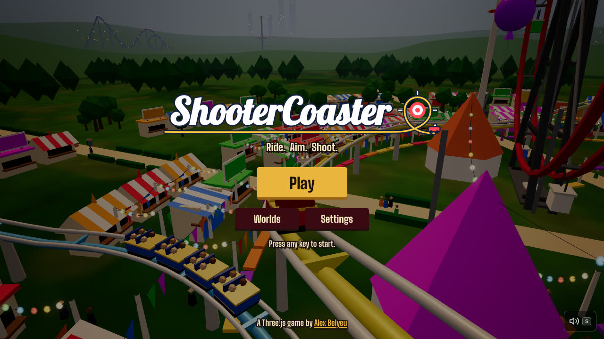
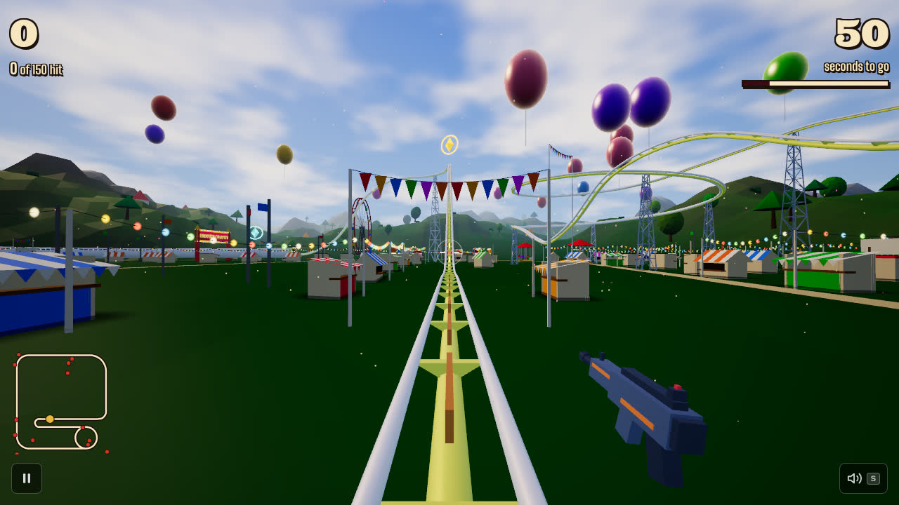
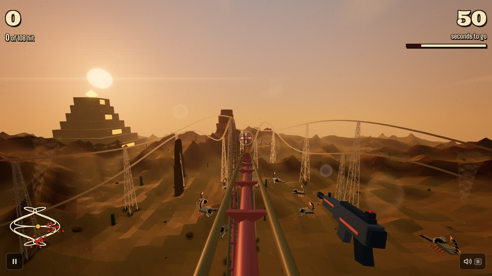
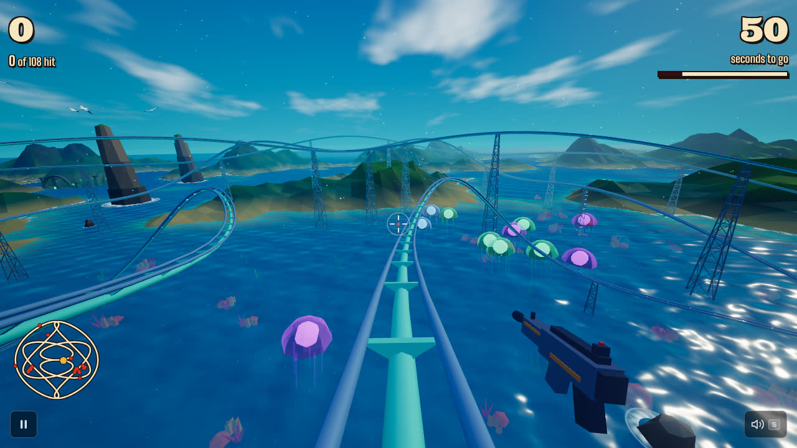
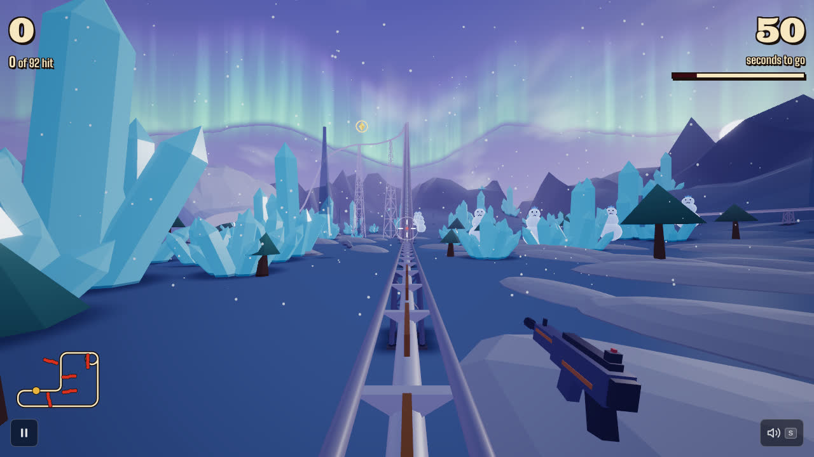
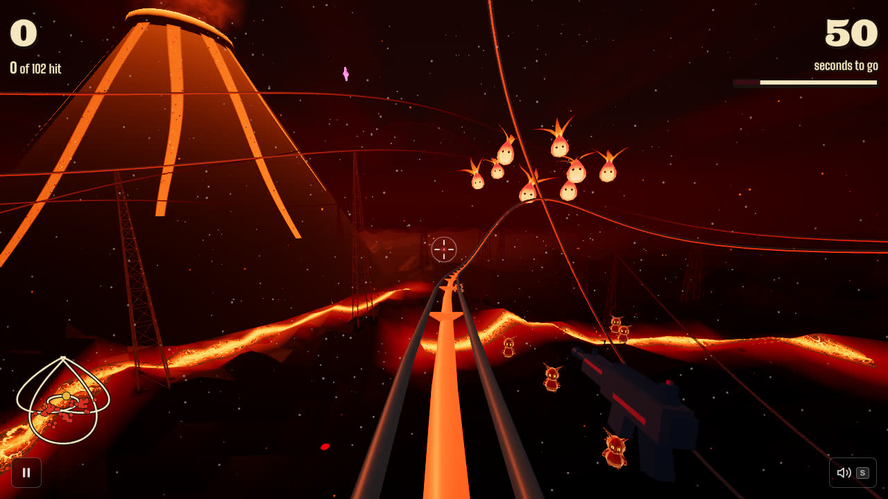
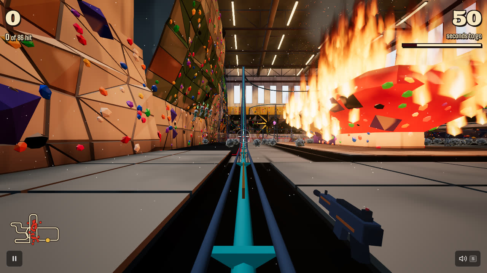

# ShooterCoaster weekly report — 2026-W47 (Mon 16 Nov – Sun 22 Nov)

## Headline

The whole game now looks and sounds like a travelling fair's shooting gallery, and every ride is a real coaster: a 10-second tour of the world before each run, launches, loops, tunnels and shoot-to-switch junctions, with the camera and sound selling the speed.

## Play it

https://scoaster.com

## What's new for players

- **The fair's look everywhere** ([#746](https://github.com/alexbelyeu/shooterCoaster/pull/746)): a written personality for the game (`docs/art/PERSONALITY.md`), then every screen rebuilt to it: title and poster ([#759](https://github.com/alexbelyeu/shooterCoaster/pull/759)), level select as ride boards with the Daily Run as a ticket ([#760](https://github.com/alexbelyeu/shooterCoaster/pull/760)), the HUD painted on the car ([#758](https://github.com/alexbelyeu/shooterCoaster/pull/758)), big moments as fair signage ([#756](https://github.com/alexbelyeu/shooterCoaster/pull/756)), the results board with chaser bulbs ([#755](https://github.com/alexbelyeu/shooterCoaster/pull/755)), leaderboard, initials and share menu ([#765](https://github.com/alexbelyeu/shooterCoaster/pull/765)), Settings ([#753](https://github.com/alexbelyeu/shooterCoaster/pull/753)), the score card ([#791](https://github.com/alexbelyeu/shooterCoaster/pull/791)), and the loading screen and 404 page ([#786](https://github.com/alexbelyeu/shooterCoaster/pull/786)).
- **Rides that feel like coasters.** A ride kit of elements (loop, zero-g roll, corkscrew, airtime, helix, head-chopper) with a camera that stays right side up through inversions ([#713](https://github.com/alexbelyeu/shooterCoaster/pull/713)); station launches, drop tracks, jump gaps and a backwards turntable ([#717](https://github.com/alexbelyeu/shooterCoaster/pull/717)); real speed from gravity, lift hills and brakes, solved so every beat still lands on its second ([#705](https://github.com/alexbelyeu/shooterCoaster/pull/705)); launch kick, drop dip, airtime float, rail rumble and chain clank ([#709](https://github.com/alexbelyeu/shooterCoaster/pull/709)); tunnels with light rings in the Theme Park ([#649](https://github.com/alexbelyeu/shooterCoaster/pull/649)).
- **Shoot-to-switch junctions** ([#721](https://github.com/alexbelyeu/shooterCoaster/pull/721), [#807](https://github.com/alexbelyeu/shooterCoaster/pull/807)): hit the switch sign and the car takes the harder branch, with its own tougher wave.
- **Before every run** ([#685](https://github.com/alexbelyeu/shooterCoaster/pull/685), [#690](https://github.com/alexbelyeu/shooterCoaster/pull/690), [#645](https://github.com/alexbelyeu/shooterCoaster/pull/645), [#711](https://github.com/alexbelyeu/shooterCoaster/pull/711)): a loading screen, a paced 10 s tour of the world that ends in your seat, then Ready / Set / GO. The results screen orbits the car.
- **The Climbing Gym rebuilt** for your notes: twice the size at level 1's coaster scale ([#614](https://github.com/alexbelyeu/shooterCoaster/pull/614), [#769](https://github.com/alexbelyeu/shooterCoaster/pull/769)), a new ride from the ride kit storyboard ([#726](https://github.com/alexbelyeu/shooterCoaster/pull/726)) through the Tree's gap ([#663](https://github.com/alexbelyeu/shooterCoaster/pull/663)) and the Training Area cave as a dark section ([#764](https://github.com/alexbelyeu/shooterCoaster/pull/764)); "spectacularly Bushwick" grime, chalk and murals ([#619](https://github.com/alexbelyeu/shooterCoaster/pull/619)), padded floors and a grey crash-pad pit ([#681](https://github.com/alexbelyeu/shooterCoaster/pull/681)); a far bigger, realistic Flame fire that lights the hall, with smoke, sparks and heat shimmer ([#623](https://github.com/alexbelyeu/shooterCoaster/pull/623), [#628](https://github.com/alexbelyeu/shooterCoaster/pull/628), [#642](https://github.com/alexbelyeu/shooterCoaster/pull/642), [#682](https://github.com/alexbelyeu/shooterCoaster/pull/682)); a bonier Medusa with a strong jaw and almond eyes ([#618](https://github.com/alexbelyeu/shooterCoaster/pull/618), [#684](https://github.com/alexbelyeu/shooterCoaster/pull/684)); a lanternfly swarm you can actually see ([#631](https://github.com/alexbelyeu/shooterCoaster/pull/631), [#678](https://github.com/alexbelyeu/shooterCoaster/pull/678)); no birds indoors ([#677](https://github.com/alexbelyeu/shooterCoaster/pull/677)).
- **Don't shoot the climbers** ([#555](https://github.com/alexbelyeu/shooterCoaster/pull/555)): bystanders on the gym walls cost you points.
- **Night Ride** ([#830](https://github.com/alexbelyeu/shooterCoaster/pull/830)): the Theme Park at night, unlocked at 3★.
- **New moments in the old worlds:** a whale breaches across the Ocean track at ~32 s ([#796](https://github.com/alexbelyeu/shooterCoaster/pull/796)); a sandstorm wave in the Desert and a blizzard in Antarctica ([#799](https://github.com/alexbelyeu/shooterCoaster/pull/799)).
- **Characters, not primitives:** the Kraken with glossy tentacles and spray at the camera ([#636](https://github.com/alexbelyeu/shooterCoaster/pull/636)); Ember Wisp, Fire Imp and Lava Golem ([#630](https://github.com/alexbelyeu/shooterCoaster/pull/630)); the Shark and the Infernal Drake ([#816](https://github.com/alexbelyeu/shooterCoaster/pull/816)). Enemy colours are now safe for colour-blind players ([#839](https://github.com/alexbelyeu/shooterCoaster/pull/839)).
- **Music:** every world's theme has a boss section and a defeat sting ([#635](https://github.com/alexbelyeu/shooterCoaster/pull/635)); your pick, Uptown Local, is the gym's score ([#653](https://github.com/alexbelyeu/shooterCoaster/pull/653)); the results screen plays a win or a lose cut by your stars ([#795](https://github.com/alexbelyeu/shooterCoaster/pull/795)); boss sounds come from where the boss is, with per-world acoustics ([#805](https://github.com/alexbelyeu/shooterCoaster/pull/805)).
- **New ways to play:** gamepad support ([#821](https://github.com/alexbelyeu/shooterCoaster/pull/821)); photo mode from pause ([#831](https://github.com/alexbelyeu/shooterCoaster/pull/831)); a track radar in the HUD ([#835](https://github.com/alexbelyeu/shooterCoaster/pull/835)); a Daily Run World board ([#855](https://github.com/alexbelyeu/shooterCoaster/pull/855)); PLAY starts your next unlocked level, WORLDS opens level select ([#811](https://github.com/alexbelyeu/shooterCoaster/pull/811)).
- **Smoother starts** for your MacBook Neo report: warm-up moved behind a hidden level and off visible frames ([#626](https://github.com/alexbelyeu/shooterCoaster/pull/626), [#658](https://github.com/alexbelyeu/shooterCoaster/pull/658)), and level 6 out of the startup JS ([#633](https://github.com/alexbelyeu/shooterCoaster/pull/633)).
- **Fixes:** a deploy while your tab is open no longer leaves the game silent ([#826](https://github.com/alexbelyeu/shooterCoaster/pull/826)); sharing the score card on iPhone ([#692](https://github.com/alexbelyeu/shooterCoaster/pull/692)); the phone share menu never covers Replay ([#843](https://github.com/alexbelyeu/shooterCoaster/pull/843)); the Kraken's eye hitbox matches its eye ([#771](https://github.com/alexbelyeu/shooterCoaster/pull/771)); Restart resets the kill count ([#588](https://github.com/alexbelyeu/shooterCoaster/pull/588)); Daily Run streaks never rewind ([#641](https://github.com/alexbelyeu/shooterCoaster/pull/641)).

## Screenshots

Taken by the smoke test at the start of each ride, on today's `main`.

## Listen

Changed this week (raw links, `main`):

- **Climbing Gym score, Uptown Local, your pick** ([#653](https://github.com/alexbelyeu/shooterCoaster/pull/653)): [music](https://raw.githubusercontent.com/alexbelyeu/shooterCoaster/main/docs/audio/renders/music-level6.mp3) · [base layer](https://raw.githubusercontent.com/alexbelyeu/shooterCoaster/main/docs/audio/renders/music-level6-base.mp3) · [seam](https://raw.githubusercontent.com/alexbelyeu/shooterCoaster/main/docs/audio/renders/music-level6-seam.mp3) · [in the mix](https://raw.githubusercontent.com/alexbelyeu/shooterCoaster/main/docs/audio/renders/mix-level6.mp3). The other two options' renders were removed.
- **Boss sections** ([#635](https://github.com/alexbelyeu/shooterCoaster/pull/635), [#805](https://github.com/alexbelyeu/shooterCoaster/pull/805)): the boss's arrival, the score's boss section and the defeat sting in the mix: [level 1](https://raw.githubusercontent.com/alexbelyeu/shooterCoaster/main/docs/audio/renders/mix-level1-boss.mp3) · [2](https://raw.githubusercontent.com/alexbelyeu/shooterCoaster/main/docs/audio/renders/mix-level2-boss.mp3) · [4](https://raw.githubusercontent.com/alexbelyeu/shooterCoaster/main/docs/audio/renders/mix-level4-boss.mp3) · [5](https://raw.githubusercontent.com/alexbelyeu/shooterCoaster/main/docs/audio/renders/mix-level5-boss.mp3) · [6](https://raw.githubusercontent.com/alexbelyeu/shooterCoaster/main/docs/audio/renders/mix-level6-boss.mp3).
- **Results music, win and lose cuts** ([#795](https://github.com/alexbelyeu/shooterCoaster/pull/795)): [win](https://raw.githubusercontent.com/alexbelyeu/shooterCoaster/main/docs/audio/renders/music-results-win.mp3) · [win seam](https://raw.githubusercontent.com/alexbelyeu/shooterCoaster/main/docs/audio/renders/music-results-win-seam.mp3) · [lose](https://raw.githubusercontent.com/alexbelyeu/shooterCoaster/main/docs/audio/renders/music-results-lose.mp3) · [lose seam](https://raw.githubusercontent.com/alexbelyeu/shooterCoaster/main/docs/audio/renders/music-results-lose-seam.mp3). They replace the single results cut.
- **Ride sounds** ([#709](https://github.com/alexbelyeu/shooterCoaster/pull/709)): GO's launch whoosh, chain lift, wind and rail rumble: [level 1](https://raw.githubusercontent.com/alexbelyeu/shooterCoaster/main/docs/audio/renders/ride-level1.mp3) · [level 6](https://raw.githubusercontent.com/alexbelyeu/shooterCoaster/main/docs/audio/renders/ride-level6.mp3).
- **Fixes you can hear** ([#647](https://github.com/alexbelyeu/shooterCoaster/pull/647), [#718](https://github.com/alexbelyeu/shooterCoaster/pull/718)): level select's [launch blip](https://raw.githubusercontent.com/alexbelyeu/shooterCoaster/main/docs/audio/renders/launch-level2.mp3) with no click at the world swap; the [resume countdown](https://raw.githubusercontent.com/alexbelyeu/shooterCoaster/main/docs/audio/renders/resume-level1.mp3) audible after pause; the [level 1 SFX sheet](https://raw.githubusercontent.com/alexbelyeu/shooterCoaster/main/docs/audio/renders/sfx-sheet-level1.mp3) and its [kill sounds](https://raw.githubusercontent.com/alexbelyeu/shooterCoaster/main/docs/audio/renders/sfx-sheet-level1-kills.mp3).

Waiting for you:
- [#900](https://github.com/alexbelyeu/shooterCoaster/issues/900) **Listen: Neon Metropolis themes** (opened today): pick level 7's score; [#901](https://github.com/alexbelyeu/shooterCoaster/issues/901) waits on it.
- [#794](https://github.com/alexbelyeu/shooterCoaster/issues/794) **Listen: results music variations**: the win and lose cuts above are already live; close it if you like them, or ask for changes.

## Under the hood

- **Ride kit:** `docs/` ride kit principles and storyboards ([#693](https://github.com/alexbelyeu/shooterCoaster/pull/693)); `TrackParams` is a union and every curve goes through one builder ([#724](https://github.com/alexbelyeu/shooterCoaster/pull/724)); the gym's pieces moved into the kit ([#814](https://github.com/alexbelyeu/shooterCoaster/pull/814)); tunnels split into pure placement and geometry ([#776](https://github.com/alexbelyeu/shooterCoaster/pull/776)); a run of edge-case fixes for towers, junctions, cameras and stop thresholds ([#774](https://github.com/alexbelyeu/shooterCoaster/pull/774), [#783](https://github.com/alexbelyeu/shooterCoaster/pull/783), [#784](https://github.com/alexbelyeu/shooterCoaster/pull/784), [#785](https://github.com/alexbelyeu/shooterCoaster/pull/785), [#817](https://github.com/alexbelyeu/shooterCoaster/pull/817)). CI renders the ride elements strip on every track change ([#782](https://github.com/alexbelyeu/shooterCoaster/pull/782)).
- **Ride gates:** a comfort check on every level's ride, and `pacing` runs on every PR that touches a level ([#762](https://github.com/alexbelyeu/shooterCoaster/pull/762)).
- **Perf tooling:** `?perf=1` splits long frames into rAF / render / timers / outside ([#621](https://github.com/alexbelyeu/shooterCoaster/pull/621)); a CPU-throttled nightly part and a gate on shaders compiled after warm-up ([#849](https://github.com/alexbelyeu/shooterCoaster/pull/849)); telemetry now reports whether the browser has WebGPU, for the renderer decision ([#851](https://github.com/alexbelyeu/shooterCoaster/pull/851)); a lanternfly in one draw call ([#688](https://github.com/alexbelyeu/shooterCoaster/pull/688)).
- **Smoke and CI:** the nightly full smoke runs as three parallel parts under its 60 min cap ([#584](https://github.com/alexbelyeu/shooterCoaster/pull/584)); settled steps get a deadline ([#767](https://github.com/alexbelyeu/shooterCoaster/pull/767)); a nightly that production redeployed under is inconclusive, not red ([#825](https://github.com/alexbelyeu/shooterCoaster/pull/825)).
- **Code health:** one owner for the scene fog ([#804](https://github.com/alexbelyeu/shooterCoaster/pull/804)); a lint rule for the slow-mo owner ([#640](https://github.com/alexbelyeu/shooterCoaster/pull/640)); shared ground-boss helpers ([#748](https://github.com/alexbelyeu/shooterCoaster/pull/748)); one ride integrator for pacing ([#738](https://github.com/alexbelyeu/shooterCoaster/pull/738)); `startRun` options and one next-level rule ([#820](https://github.com/alexbelyeu/shooterCoaster/pull/820)); one `BIOME_TYPES` list ([#694](https://github.com/alexbelyeu/shooterCoaster/pull/694)).
- **Studio:** a process tune-up (code map out of `CLAUDE.md`, QA never approves conflicts) ([#655](https://github.com/alexbelyeu/shooterCoaster/pull/655)); review bundles 5–8x smaller ([#656](https://github.com/alexbelyeu/shooterCoaster/pull/656)); builders wrap up at 150k context ([#773](https://github.com/alexbelyeu/shooterCoaster/pull/773)) and hand off unfinished work instead of blocking ([#808](https://github.com/alexbelyeu/shooterCoaster/pull/808)); the watchdog flags Builders idle for 3 h while issues are ready ([#747](https://github.com/alexbelyeu/shooterCoaster/pull/747)).
- **Size:** 146 PRs, 151 commits on `main`; 615 files changed, +36,370 / −7,430 lines. Twice last week's 55 PRs.

## Players

From the Marketer's W47 metrics (`docs/marketing/metrics/2026-W47.md`): **19 visitors** (W46: 26, −27%) and **24 page views** (W46: 42), all direct; no search visit. 32% on a phone (W46: 19%). 15 level starts, 9 completes (7 at 3★), 4 quits, 0 shares. Most play came from two US iPhones; outside them, 2 of 13 visitors started a level.

You answered [#610](https://github.com/alexbelyeu/shooterCoaster/issues/610) on 18 Nov: **no public post until the game is AAA, ten worlds at the highest level** (milestone M4). So this was a fourth quiet week by design, and no marketing draft is waiting for you.

## Health

HEALTH_PLACEHOLDER

## Token use

Weighted tokens from the ledger for 16 Nov 05:00 UTC to 23 Nov 05:00 UTC: **230.6M over 398 runs**, against 90.7M over 117 runs last week (**+154%**), for 146 merged PRs against 55 (about 1.6M per PR, against 1.6M last week: the same cost per PR, at 2.7x the output).

| Role | Runs | Total |
|---|---:|---:|
| Builders | 75 | 136.2M |
| QA (on label) | 223 | 57.4M |
| Fix (on label) | 80 | 23.3M |
| Maintainer | 7 | 9.2M |
| Director | 6 | 1.9M |
| QA (scheduled) | 5 | 1.4M |
| Reporter | 1 | 0.8M |
| Marketer | 1 | 0.4M |

Most expensive merged PRs (the PR's ref plus the issue it closes):

| PR | Weighted tokens | Sent back |
|---|---:|---:|
| [#796](https://github.com/alexbelyeu/shooterCoaster/pull/796) whale breach in the Ocean | 6.0M | 3 |
| [#769](https://github.com/alexbelyeu/shooterCoaster/pull/769) a bigger gym, slower and smoother ride | 5.9M | 0 |
| [#726](https://github.com/alexbelyeu/shooterCoaster/pull/726) gym ride rebuilt from the ride kit | 5.7M | 1 |
| [#663](https://github.com/alexbelyeu/shooterCoaster/pull/663) ride through the Tree's gap | 4.7M | 2 |
| [#690](https://github.com/alexbelyeu/shooterCoaster/pull/690) 10 s world tour before each level | 4.0M | 3 |
| [#807](https://github.com/alexbelyeu/shooterCoaster/pull/807) hard-branch wave | 3.9M | 3 |
| [#721](https://github.com/alexbelyeu/shooterCoaster/pull/721) shoot-to-switch junctions | 3.8M | 2 |
| [#709](https://github.com/alexbelyeu/shooterCoaster/pull/709) ride feel: camera and sound | 3.3M | 0 |
| [#830](https://github.com/alexbelyeu/shooterCoaster/pull/830) Night Ride | 3.2M | 3 |
| [#816](https://github.com/alexbelyeu/shooterCoaster/pull/816) Shark and Infernal Drake | 3.0M | 2 |

Why the top three cost what they did: **#796** went back from QA three times (the breach has to land in view on a ride whose timing other PRs were changing that week); **#769** and **#726** each rebuilt the gym's whole ride, and every rebuild re-runs level 6's long pacing, comfort and boss smoke loops (#769 later broke the nightly's level 6 boss step, below). None crossed 10M; the most-sent-back PR was [#774](https://github.com/alexbelyeu/shooterCoaster/pull/774) (towers out of tunnels, 6 rounds, 2.8M).

## Next up

- **M3 — Depth and spectacle:** 87 of 90 issues closed (97%), due 5 Dec, 12 days left. Open P1: the epics [#513](https://github.com/alexbelyeu/shooterCoaster/issues/513) Level 6 and [#381](https://github.com/alexbelyeu/shooterCoaster/issues/381) enemy art.
- **M4 — Ten worlds, every ride a thrill:** 31 of 50 issues closed (62%), due 7 Jan, 45 days left. Open P1: [#323](https://github.com/alexbelyeu/shooterCoaster/issues/323) Neon Metropolis playable slice (its PR [#881](https://github.com/alexbelyeu/shooterCoaster/pull/881) is open) and the epic [#322](https://github.com/alexbelyeu/shooterCoaster/issues/322) level 7.

In review now: the Desert, Ocean and Inferno rides rebuilt from the ride kit ([#892](https://github.com/alexbelyeu/shooterCoaster/pull/892), [#893](https://github.com/alexbelyeu/shooterCoaster/pull/893), [#898](https://github.com/alexbelyeu/shooterCoaster/pull/898)), medals ([#904](https://github.com/alexbelyeu/shooterCoaster/pull/904)) and the on-ride photo ([#887](https://github.com/alexbelyeu/shooterCoaster/pull/887)).

Top `agent:ready` issues now: [#921](https://github.com/alexbelyeu/shooterCoaster/issues/921) Neon Metropolis's elevated highway; [#880](https://github.com/alexbelyeu/shooterCoaster/issues/880) Night Ride for the Desert and the Ocean; [#911](https://github.com/alexbelyeu/shooterCoaster/issues/911) scenery out of Antarctica's ice cave.

Also waiting on you: [#561](https://github.com/alexbelyeu/shooterCoaster/issues/561), a new `?perf=1` report from the MacBook Neo (Level 1 then Level 2, Copy report, paste it there); the Safari stall-burst fix #620 is planned from it.

## Steer me

Edit `docs/agents/STEERING.md` on GitHub, or open an issue labelled `steering`. Setting `pause: true` there stops every scheduled run.
